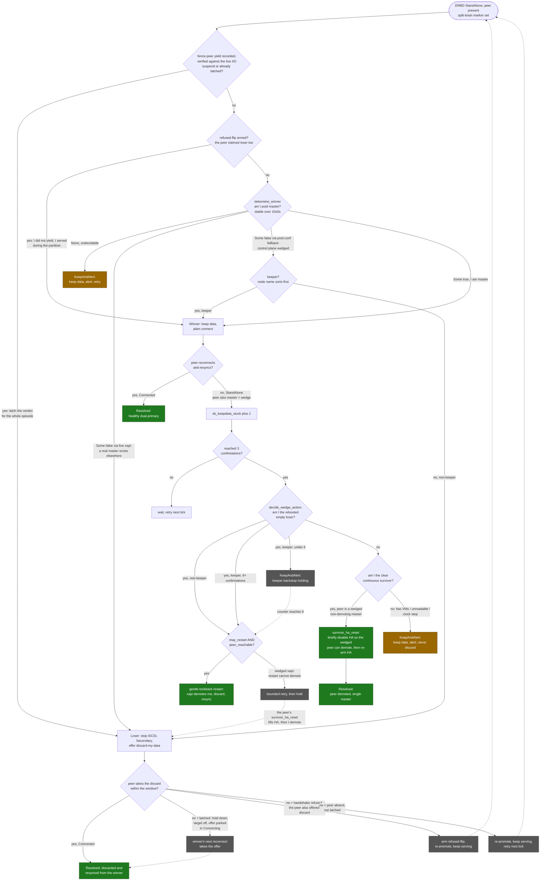
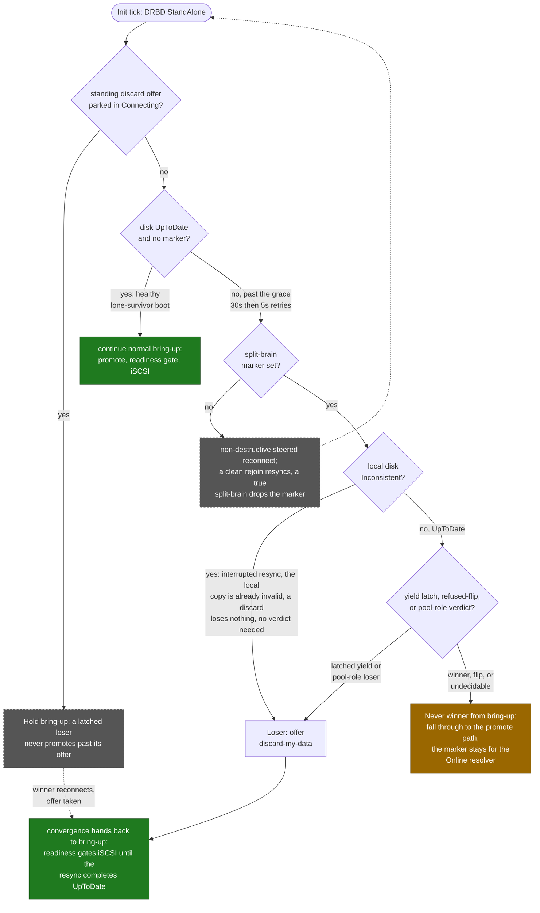

# TwinStor convergence reference

This document answers one question: **after a failure, once the hosts are back
online, does the cluster return to a healthy state (both DRBD
`Primary`/`UpToDate`/`Connected`, one XAPI pool master) on its own?** It is
the design reference for the daemon's split-brain and dual-master recovery
logic; source comments point here rather than repeat it.

Every recovery path ends in one of two outcomes:

- **Converge:** the daemon resolves the situation and the cluster returns to
  healthy, with no operator action.
- **Fail-safe:** the daemon cannot decide safely, so it discards nothing,
  keeps serving, and alerts. An operator finishes the recovery. **No data is
  discarded on doubt.**

There is no third outcome in which the cluster silently diverges or destroys
data. The paths that stop short of converging are listed, with the reason,
under [What does not auto-converge](#what-does-not-auto-converge-and-why).

Converging on a true split-brain (both sides served writes) does discard the
loser's diverged writes. Prevention makes that event rare, and a visible,
crash-consistent rollback (the loser's VMs are stopped before the discard and
rebooted on the winner) is preferred over a held outage. The divergence lasts
as long as the replication cut, or until XHA fences one side (197 s observed
with HA armed and a 90 s HA timeout); it is not capped at the HA timeout, and
the loser's acknowledged writes for that whole period are discarded. TwinStor
reports the approximate volume discarded but does not keep a copy of it. The
design position and the prevention layers are in
NETWORK_TOPOLOGY_SAFETY.md ("The divergence budget").

This complements [BEHAVIOR.md](BEHAVIOR.md) (the case index) and
[NETWORK_TOPOLOGY_SAFETY.md](NETWORK_TOPOLOGY_SAFETY.md) (network and fence
mechanics). It describes the fate-shared (single-path) topology unless noted.

## The dual-master wedge

The hardest control-plane failure is the **dual-master wedge**. After a
partition (typically a host that lost its links, self-fenced, rebooted and
joined while still isolated), the XHA statefile forks and both hosts'
`/etc/xensource/pool.conf` read `master`. DRBD then refuses to auto-resolve
and sits `StandAlone` on both sides (each host kept its data, so neither will
discard). The cluster is data-safe but cannot serve redundantly until one side
yields. The daemon detects this from local signals only (there is no
host-to-host control channel) and resolves it as below.

The common way into the wedge, a rejoining isolated host promoting into a
race, is closed before the wedge can form: the startup connection wait is
re-armed when the peer becomes reachable again, with a 30 s wall-clock hold,
and the fence-peer handler refuses a promote-time outdate while the peer's
DRBD port accepts connections. The resolution ladder below covers the
remaining ways in (a forked XHA statefile, symmetric partitions).

Episode progress is written to `/run/twinstor/heal-state.json` and shown by
`twinstor status`. Repeated episodes (3 in 15 minutes) raise a
`twinstor_flapping_link` alert.

## The resolution decision tree

When a host sees its DRBD link `StandAlone` with the peer present and the
split-brain marker set, it resolves the situation from local signals only,
once per tick. There are two entries into this logic:

- the **Online** tick: the tree below;
- the **bring-up (Init)** tick: a restricted, loser-only ladder (second
  diagram). A host that boots with a disk it cannot promote can never reach
  Online on its own, so it cannot wait for Online.

Green nodes converge, amber nodes are fail-safe holds, grey dashed nodes are
transient steps that loop back.

### Freshness first: the generation-lineage override

Everything after this step (the pool-role read, the keeper tiebreak, the
disk-label freshness gate) decides who keeps from identity and role, not from
who holds the newer writes. That is safe only while it never contradicts data
currency, and it can. DRBD's disk-state labels do not say who is fresher:
`UpToDate` and `Consistent` mean "did I stay a healthy primary", not "who
advanced". A host that keeps serving while its peer is gone stays `UpToDate`;
a host that crashed while serving the newest writes comes back `Consistent`.
A role or label decision can therefore elect the stale survivor and roll the
fresher, crashed copy back, discarding committed guest writes.

The signal for data currency is the **DRBD generation lineage**: the Current,
Bitmap-base and History generation UUIDs each host stamps as it writes.
TwinStor reads both sides' generations from the `drbd_sync_handshake` block
DRBD logs to the kernel at every connection attempt (the only place a
`StandAlone` host can see the peer's UUIDs), and resolves from that first:

- **This host descends from the peer** (the peer's Current UUID is in this
  host's bitmap-base or history): this host holds every write the peer has,
  and more. **Keep.**
- **The peer descends from this host:** this host is strictly behind.
  **Discard** and resync from the peer; nothing that exists only here is lost.
- **Currents are equal:** no real divergence. Defer to the role and keeper
  election below (either copy can be the source).
- **Neither descends from the other:** a **true fork**. Both sides advanced
  from a common ancestor, no merge exists, and converging has to roll one side
  back. TwinStor keeps the side with more unreplicated writes (the one whose
  loss is smallest) and raises a `twinstor_split_brain_diverged` alert naming
  the rolled-back host and the approximate volume discarded. A tie keeps on
  both sides, which is a held disconnect (`after-sb-0pri disconnect`), never a
  mutual discard.

Both entries use this. The Online resolver applies the full verdict. The
bring-up (Init) resolver may act on a `discard` verdict but never elects a
winner from boot; a `keep` verdict only defers to the promote path (a boot
must never promote data it has not proven current). When the handshake
generations cannot be read (a lone survivor whose peer never returned, or the
kernel ring buffer wrapped), resolution falls through to the role and keeper
path unchanged.

A true fork is where the CAP trade-off cannot be avoided: there is no copy
that holds both sides' writes, so a converging pool has to lose acknowledged
writes. TwinStor:

1. makes it rare: fencing, `suspend-io` and the stand-down path all work to
   stop both hosts writing while disconnected;
2. when it happens, minimizes the loss by keeping the most advanced copy,
   rather than choosing by role;
3. never does it silently (the alert).

Workloads that cannot tolerate even that should keep their replicas (for
example the VMs of an application cluster) anti-affine: pinned so they never
run on the same host, so a single host loss cannot fork their data. See FAQ.md, "Can TwinStor lose committed writes?".

### The symmetric mutual-loser tiebreak

The `Some false` verdict branches on how it was read. `determine_winner` reads
mastership resiliently: the live XAPI answer if it responds, else the local
`pool.conf` role (see
[Resilient mastership read](#resilient-mastership-read-determine_winner)).

- `Some false` from **live XAPI** means slave-to-master forwarding works, so a
  reachable master exists elsewhere. This host is a real loser, discards, and
  converges on that master.
- `Some false` from the **`pool.conf` fallback** is the signature of a wedged
  control plane, which is what a split-brain produces. When both hosts are in
  that state, both read "not master" and neither elects itself the sync
  source. Left alone, both would offer `--discard-my-data` and mutually
  discard, a symmetric wedge that cannot converge. Breaking it on DRBD's
  refusal timing alone (the refused-round flip, below) could miss for
  minutes and, under the resulting iSCSI churn, overload the local target and
  reboot the pool (observed in testing).

The symmetric case is broken by the **keeper**, the same static node-name
order used to stagger the dual-master wedge
([below](#identifying-the-spurious-master-the-loser)). The keeper keeps its
data as the single sync source; the non-keeper discards and resyncs. Both
hosts compute the same answer from static identity with no communication, so
it converges in one pass and the two answers are always opposite.

This does not weaken the fail-safe rule:

- The tiebreak fires only on a stable `Some false` from the fallback, never on
  doubt (`None` still holds and alerts).
- It only changes the keeper's action (from discard to keep). The non-keeper
  discards either way, so no new discard is introduced: the non-keeper's
  diverged writes (what it acknowledged on its own while the split lasted) are
  discarded as the loser alert announces, its VMs rebooted onto the kept copy
  first.
- The worst case of a misfire is "both keep" (a data-safe hold), never "both
  discard".
- A live-readable master always overrides it, so a real loser still discards
  and converges on the real master.
- It is not gated on a live DRBD connection: a split-brain sits `StandAlone`
  by definition, so requiring a connection would make the keeper fall through
  and mutually discard. The keeper keeps its data whether the peer is present
  (it is the single sync source) or absent (a lone-survivor keeper serves its
  own copy).

**Backstop:** if resolution fails to converge for an unforeseen reason, four
or more resolution cycles within ten minutes, auto-resolve pauses and holds
both copies intact (no discard, no iSCSI teardown), with an operator alert and
a `twinstor status` heal state. It resumes on its own once the pool settles.
The known cases should never reach it; it turns an unknown non-convergence
into a held outage rather than a reboot loop.

### The bring-up (Init) entry: loser only

A host that boots `StandAlone` with a disk it cannot promote (an
`Inconsistent` replica after a fence interrupted a resync) never reaches
Online, so bring-up runs its own restricted ladder. **Bring-up can resolve as
the loser but never as the winner**, so a wrong or unstable verdict during
boot can at worst delay convergence, never discard the good copy. A healthy
boot (`UpToDate`, no marker) passes straight through, so a lone-survivor boot
is not delayed.

## The loser crash boundary

Converging on a true fork rolls the loser's disk back to the winner's history.
Withdrawing the loser's target is not enough on its own: multipath moves the
loser's still-running VMs onto the peer's portal, so they keep running on the
winner's blocks with page cache and file-system state from the discarded ones.
The result is foreign bytes inside files, invisible to fsck and to database
integrity checks. The loser therefore stops those VMs first
(`src/loser_boundary.rs`; see also
[RECOVERY_CRASH_BOUNDARY.md](RECOVERY_CRASH_BOUNDARY.md)).

1. **When it applies.** The resolver passes what it knows about the
   divergence. A lineage true fork, no readable lineage at all, or a verified
   fence-peer yield (its guests may hold writes frozen in flight, which the
   discard path would complete) requires the boundary. A lineage "behind" or
   "equal", or an `Inconsistent` local replica, does not. Neither does a
   bring-up loser whose target is positively not exported in the kernel
   (configfs), since nobody could read the losing history through it. An
   unreadable export state counts as exported.

2. **Order of steps,** all before any admission change, in one resolver
   round:
   - Scan locally (`xl list -v` plus the block backends under
     `/local/domain/0/backend` in xenstore) for every guest domain with a disk
     on the SR. In parallel, each cut off after 5 s, XAPI lists the VMs
     resident on this host with a disk on the SR (names, the restart
     obligation, a cross-check), and the host is disabled (best effort: with
     pool HA armed and a failures-to-tolerate of 1, XAPI refuses to disable
     either host of a two-host pool).
   - Record them durably (`/var/lib/twinstor/loser-boundary`, write to a
     temporary file, fsync, rename).
   - Ask XAPI, in the background, to hard-stop the guests both views place
     here (when XAPI answers, the stop is recorded as intended).
   - Power off every such domain at the hypervisor, all at once (dom0's
     `xen.lowlevel.xc`, reason poweroff): the vCPUs stop at once, and xenopsd
     collects the domain as a guest shutdown with its own disk teardown,
     never a crash rebuild.
   - Re-scan, and destroy (`xl destroy`) any domain still running, at most
     twice; hold if one still runs.
   - Once nothing on the SR runs, lift a leftover I/O suspend on this copy (a
     yield's frozen writes would otherwise hold every disk handle open).
   - Give xenopsd up to 8 s to collect the powered-off domains, and destroy
     only what it left.
   - Release the disk handles the stopped guests left (below).

   The critical path never waits on XAPI. The split lasts until the loser
   discards, and with pool HA armed the XHA statefile on the replicated SR is
   split for that whole time, so a slow boundary turns a short cut into an
   XHA fence (observed in testing when guests were stopped one per round
   through XAPI, about 37 s each). The local scan is the authority. It also
   catches a domain XAPI does not attribute to this host (an incoming
   migration, a stale resident-on), which is destroyed and owed a restart like
   the others. XAPI's list is cross-checked against the scan: a listed guest
   with a domain here that the scan does not see on the SR means the scan does
   not understand this host, and the boundary holds.

   **Disk handles:** when xenopsd's own teardown did not run, XAPI's storage
   layer keeps the dead domains' datapaths (`vbd/<domid>/<device>`) activated,
   and their tapdisks keep the VHDs open with the losing history's metadata
   cached; a later start on this host would reuse that attachment. They are
   released through the storage layer (`DP.destroy`), with `tap-ctl destroy`
   only as a fallback, before the discard, and only while the close lands on
   this host's own copy (this host's active multipath path is its own portal).
   A tapdisk whose disk a live domain holds (a guest being started here) is
   never closed; that guest is stopped first. This step is bounded at 20 s. A
   datapath that is not released is recorded and retried, and no guest using
   it starts here until it is.

   When all of this is done, the record says `stopped`. The scan is read once
   more just before the first admission change (a guest found again is
   stopped again at once, in the same round), and the normal loser path runs
   in the same round (loopback logout, target teardown, demote, discard). A
   local destroy can leave XAPI recording the VM as `running`; that record is
   reconciled before the restart.

3. **Restarts.** Right after this copy is withdrawn (target down, Secondary,
   discard offered), a last check stops any guest domain on the SR that
   already existed at that point (through XAPI first, so pool HA leaves it
   down), drops it from the owed restarts, and alerts with its VDIs: it may
   have run across the discard. The record is then marked `discarding`, and
   the owed VMs are started one per tick, outside the tick (a failed start is
   retried after 15 s; each step applies only its own changes to the record),
   on the winner's XAPI host, addressed by uuid (never an unconstrained
   `vm-start`, which could start a VM twice in a split pool).
   - A VM counts as already running only if XAPI places it on another host, or
     a domain for it exists here.
   - A start that keeps failing is alerted after ten attempts and retried
     every 15 minutes, never dropped.
   - Once this host has rejoined, a VM the winner keeps failing to start
     (twice) is started on this host instead, after its disks are proven free
     of stale handles.
   - An unreadable record is alerted once.
   - A discard round that flips this host to winner defers the restarts to the
     end of the episode, when both copies are the same again, and they start
     on this host.

   The record survives a daemon restart (uninstall removes it). It is a
   restart obligation only and never authorizes a stop: every run re-scans
   live.

4. **Hold.** Any step that cannot be completed or confirmed (the local scan, a
   disagreement between the scan and XAPI's list, a domain surviving two
   destroy rounds, a disk handle that cannot be closed, the record) stops the
   sequence before the discard. Both copies stay intact and the loser keeps
   serving its own copy, as for an undecidable winner. The alert names the
   failed step and the manual fix (`twinstor discard-and-resync`, see
   BEHAVIOR.md case 21). The boundary retries every minute and completes by
   itself once the cause clears. Guests already stopped are restarted on the
   winner during the hold when the lineage decided the loser; when divergence
   could not be read they stay stopped until the episode ends.

5. **Winner side.** A VM on the winner host is exposed only if it reached the
   peer's portal, which requires the winner's local path to be down. The path
   watchdog flags any probe, since the pair was last redundant, that could not
   confirm the local path as active; the winner then alerts with its VM list
   when the episode ends, whichever path converges it. This is sampled (every
   few ticks), so it is a warning, not a proof.

Consumers that are not guests are left as they are:

- **XHA statefile and heartbeat VDIs** (dom0, on the SR): each host writes its
  own slots and reads the others'. After the switch the loser reads the
  winner's copy of the shared state, and its own slot reverts to what the
  winner holds; xhad rewrites its slot on its next cycle. No action needed.
- **SM metadata** (the LVM volume group on the SR): VDIs created, resized or
  deleted on the loser's side during the split are rolled back with the rest
  of its copy, while XAPI's database may still reference them. This comes
  with discarding a fork, not with the live switch; the alert says to check
  the named VMs.
- **Dom0 attachments of VDIs** (backup or export jobs reading a VDI through
  tapdisk on the loser): such a reader would see the history change under it
  and produce an inconsistent export. These are not enumerated; they are rare,
  and the result is a bad backup, not a corrupted VM.

## The yielded-loser override and the episode latch

The pool-role rule has one blind spot: the host whose stale `pool.conf` says
"master" can be the host that served nobody. When the pool master loses its
client-facing path, its fence-peer yields (suspends I/O and records the yield
in `/run/twinstor/fence-yielded`), XHA elects the peer, and the pool serves
from there. The frozen former master could not take part in the election, so
its local role still reads "master" and its xapi may be hung. Resolved by pool
role alone, both sides would claim the win and the resolution would deadlock;
worse, resolving the frozen host as the winner would discard the writes the
surviving peer acknowledged to clients throughout the partition.

The override closes this with local knowledge only, in four layers:

- **Verification.** A recorded yield is trusted only while the yield's I/O
  suspend is still in place, which proves the host has served nobody since its
  own handler froze it. A yield marker without the suspend (the host resumed
  and may have served writes since) is stale evidence and never forces a
  discard.
- **The episode latch.** Running the loser path lifts the suspend, so the
  verification can only pass once, but the verdict must outlive it. A discard
  round can find nobody listening (the peer's resolver runs on its own grace
  timer), and without a latch the retry would fall back to the pool-role rule
  and invert the winner. The verified verdict is therefore latched on disk
  (`/var/lib/twinstor/yield-loser-latched`, holding this host's current DRBD
  generation, so it survives a reboot for the same fork and goes stale by
  itself once the generation moves) and re-applied every round until the
  episode ends.
  - While latched, a timed-out round holds the host down (Secondary, target
    off) instead of re-promoting and serving stale data between rounds; the
    surviving peer owns availability for the rest of the episode.
  - The discard offer is left parked in `Connecting` between rounds (a merely
    absent peer parks it there), so the winner's next reconnect takes it
    whenever it comes. A disconnect-and-retry cycle instead could miss the
    winner's own reconnect window for minutes (observed in testing).
  - Yield, latch, the parked offer and any armed flip are cleared together
    once the host serves with redundancy again and when a resolution
    converges. A reboot clears the `/run` markers but not the latch.
- **The yield claim.** A yield decides only when no guest on the SR ran on the
  yielded host. (With freeze mode off, fate-shared I/O flows until the
  handler freezes it, so guests that ran there may hold acknowledged writes
  the peer lacks; then the lineage decides on both hosts.) For such a
  guest-free yield the host latches at once and serves `Y<generation>` on the
  peer beacon (port 7900), bound to its current DRBD generation. The
  surviving peer reads it at the start of its resolver, compares the
  generation with the peer generation in its own handshake read (so a claim
  from another fork never matches), and takes the win whatever its lineage
  counts say: a few in-flight blocks or XHA statefile writes on the frozen
  side must not make the survivor discard too. It records the win durably for
  the fork and serves `W<loser's generation>` (the loser's generation stays
  fixed while it holds down; the winner's own changes at its first write). A
  host that reads a `W` naming its own generation resolves as the loser.
  Neither host acts on an old, missing or unreachable beacon answer.
- **The refused-round flip.** DRBD refuses a `--discard-my-data` handshake
  only when both sides offer, so a loser whose discard lands back in
  `StandAlone` knows the peer also claims loser. It takes the win when it is
  the keeper or when the peer's beacon attests a yield for this fork, and
  never when the peer attests a win; otherwise it holds. The latched host can
  never flip (it holds down), so the pair converges with the survivor's data
  winning. A flipped host withdraws its own earlier offer before reconnecting
  (below). Both hosts still refusing after 5 minutes is alerted with the
  manual step.

A **mutual yield** (both fence-peers yielded and froze) latches both sides:
both hold down, both alert, and no data is discarded. That is the fail-safe
outcome. Once the operator (or a verdict flip) picks the survivor, the rest is
automatic:

- A plain reconnect first withdraws any stale kernel discard offer. DRBD keeps
  that offer on the peer object until a handshake completes, a promote
  succeeds, or the peer object is re-created (`--discard-my-data=no` does not
  clear it), so the daemon re-creates the peer object when debugfs still shows
  the flag.
- A winner that converged while still demoted re-enters bring-up on its own to
  re-promote and restart its target.

Two non-yielded losers (a masterless pool, both `pool.conf` reading slave) are
the symmetric mutual-loser wedge, resolved by the
[keeper tiebreak](#the-symmetric-mutual-loser-tiebreak): the keeper keeps as
the single sync source, the non-keeper discards and resyncs, in one pass. The
refused-round flip remains a backstop for the rare case where both hosts read
`Some false` from live XAPI (a masterless pool that the tiebreak does not
touch).

## The dual-master auto-heal in detail

### Resilient mastership read (`determine_winner`)

`determine_winner` answers "am I the pool master?" and anchors every decision.
It reads the live XAPI answer if XAPI responds, else the local `pool.conf`
role. A wedge can break the loser's slave-to-master XAPI connection: a
partition, or a self-referential or corrupted master address in `pool.conf` (a
host whose recorded master is its own stale uuid, so its own `xe` cannot
resolve it). That is when resolution must still proceed, and the local file
read cannot be wedged that way; it still reports the correct master or slave
role. The verdict must be stable across 10 reads spaced 5 s apart; any flip or
unreadable read gives `None` (wait, never act), which is what makes the
undecidable case fail safe.

The read also reports where the stable verdict came from: live XAPI or the
`pool.conf` fallback. That drives the
[symmetric mutual-loser tiebreak](#the-symmetric-mutual-loser-tiebreak): a
live `Some false` means a reachable master exists (converge on it); a fallback
`Some false` on both hosts is the wedged-control-plane signature the keeper
tiebreak resolves.

### Identifying the spurious master (the loser)

A host yields only if it is a clear empty loser: `rebooted_since_healthy()`
(its boot time is newer than its persisted last-healthy stamp, see
[Why this does not depend on boot time](#why-this-does-not-depend-on-boot-time))
and it runs zero VMs. The continuous survivor never reads `rebooted=true`, and
a serving host has VMs. If either condition is unreadable: KeepAndAlert
(never discard on doubt).

The **keeper** (the host whose configured node name sorts first) is the
tiebreak. The non-keeper yields after the wedge is confirmed 3 times
(`DUAL_MASTER_WEDGE_ATTEMPTS`, about 15 s of confirmations); the keeper holds
until the wedge has been confirmed `KEEPER_BACKSTOP_ATTEMPTS` (6) times. With
this staggering, a rare symmetric both-loser wedge is resolved by the
non-keeper first, so the two never demote at once (which could leave the pool
with no master). The keeper reaches its backstop only when the non-keeper
failed to resolve: normally the non-keeper demotes, the keeper sees the
reconnect, and its counter resets before it would fire.

### Gentle demote (healthy xapi)

A yielding host demotes by restarting its own toolstack, gated on
`peer_reachable()` and a bounded retry budget. It runs `xe-toolstack-restart`;
XAPI's startup reconciliation finds the survivor still master and demotes this
host to slave, with HA left armed (no `pool-emergency-reset-master`, no HA
disable). This works whenever the rejoining host's XAPI is healthy.

The demote can take minutes to settle (XHA re-promotes the keeper while DRBD
is still `StandAlone`). During that settle `determine_winner` returns `None`,
and that churn resets the retry patience counter, so a retry does not
interrupt a demote in progress. Retries are bounded by
`AUTOHEAL_MAX_RESTARTS` (3), spaced by `AUTOHEAL_REARM_AFTER_HOLDS` (4)
confirmations.

### Stranded former master on rejoin (healthy DRBD)

The gentle demote keys on the dual-master wedge: both hosts master while DRBD
is `StandAlone`. A returning isolated master produces a different shape. After
its switch-path stand-down (BEHAVIOR.md case 39) and the survivor's emergency
master transition, it comes back with DRBD `Connected`/`UpToDate` (it stood
down as `Secondary`, so it resyncs cleanly) but its XAPI still reads itself as
pool master. That is a dual-master with healthy DRBD, which the
`StandAlone`-keyed wedge path never sees: the host sits `enabled=false`, not
live, runs no VMs, HA cannot re-arm, and it loops waiting for XAPI.

The daemon detects this each tick from local signals: it reads as pool master,
its peer is alive and `UpToDate` on the replication link, it runs zero VMs,
and either the peer reads not live in its own pool database (the signal when
xapi works) or its own xapi is hung (`xapi_hung`: the master verdict came from
the `pool.conf` fallback, not a live `xe`). Zero VMs tells the two masters
apart: the real survivor holds all the VMs, so only the empty, stranded former
master matches. The `xapi_hung` alternative is needed because in the real
wedge the stranded host's own xapi hangs, so the forwarded `peer_host_live`
read behind the first signal returns nothing; without it the strand would
never be detected.

On a persistent match (past a short debounce that ignores a peer that is
merely booting), it runs the same non-destructive `xe-toolstack-restart` the
gentle demote uses, so XAPI demotes it to slave and HA re-arms on its own. If
those restarts do not demote it (the wedged XAPI keeps reading itself as
master), the daemon escalates to a **forceful demote**, the automated form of
the manual procedure. The wedged XAPI rejects every operation ("could not join
the liveset: HA daemon could not access the heartbeat disk") while its local HA
state is stuck, so this takes two steps:

1. `xe host-emergency-ha-disable --force` (local, always works, clears the
   stuck HA state);
2. `xe pool-emergency-reset-master master-address=<peer>`.

This reset asserts slave: it rewrites `pool.conf` to slave of the survivor and
restarts the toolstack, so it can never create a new master. (A bare
reset-master without the forced disable first does nothing.) It is gated on
the survivor's management IP being reachable: while this host is still
isolated it defers (`stranded_master_force_reset_deferred`) without spending
an attempt, and fires once the network returns. Past the force-reset cap it
stops and alerts for a manual reset-master. Outcome: converge.

### Survivor HA reset for a wedged peer

Sometimes the rejoining host's XAPI comes back wedged: a self-referential
master whose own reconciliation cannot resolve it (every `xe` returns "invalid
uuid" for its own host). The cause: on joining at boot, its xapi tries to
self-correct with `pool.emergency_reset_master`, but XAPI rejects that with
`HA_IS_ENABLED` while HA is armed, so it stays a broken master and the gentle
toolstack restart hits the same wall every time.

The daemon does not try to force this from the wedged host by rewriting
`pool.conf` directly. That updates only the file and leaves XHA's statefile
stale, so XHA re-promotes host[0] in a self-sustaining flap, which is worse
than a quiet hold (the `mastership_flap` signal exists to catch it).

The recovery is driven by the **survivor**, the only host with a working `xe`.
When the survivor is the clear continuous master (`rebooted_since_healthy()` =
`Some(false)`) and the peer is a wedged second master that does not demote, it
runs `survivor_ha_reset`:

1. briefly `pool-ha-disable`, which lifts the `HA_IS_ENABLED` block so the
   wedged peer's own reconciliation finally demotes it to slave;
2. wait for DRBD to resync;
3. always re-arm HA (`pool-ha-enable`): the pool is never left unprotected.

No reboot, no `pool.conf` rewrite, no flap. The peer demotes in place and
resyncs; the survivor keeps serving throughout. At most one reset is in flight
at a time (retried on later confirmations if the wedge persists), and it is
bounded by a timeout after which HA is re-armed and the operator is alerted.

The survivor HA reset and the stranded-former-master force-reset are two
levers on the same `HA_IS_ENABLED` wall, ending in the same single-master
state:

- the survivor HA reset lifts the block pool-wide from the survivor
  (`pool-ha-disable`) so the wedged peer demotes itself;
- the force-reset clears it locally on the stranded host
  (`host-emergency-ha-disable --force`) and then reset-masters that host to
  slave. It targets the stranded-former-master shape (hung xapi, zero VMs) and
  needs nothing from the wedged host's `xe` beyond the emergency commands.

Both end by re-arming HA. They do not conflict (either one collapsing the fork
satisfies the other's gate), but the force-reset is the more direct path for
the returning-master wedge, because it does not depend on the survivor
correctly reading itself as the clear continuous master.

### Loser ordering: stop iSCSI before discarding

Once a host is confirmed the loser (`determine_winner` = not master), it stops
iSCSI before demoting and discarding: lift any I/O suspend, stop the target,
go `Secondary`, then `connect --discard-my-data`, then restart iSCSI once
resynced. Stopping iSCSI first means HA restarts that host's VMs on the
survivor's consistent copy rather than rewriting their disks underneath them.
If the LIO teardown wedges on suspended kernel I/O, the host self-fences
(forced reboot) to break it. That is safe because it is the discarding side.

### Management-path reachability gate

The yield is gated on `peer_reachable()`, which probes the management RPC path
the demote actually uses (XAPI's `check_no_other_masters` and
`ha_propose_master`), not the DRBD replication link. In the single-path
topology they are the same interface. In a split-path or arbitrated deployment
the replication link can be up while management is partitioned, so the gate
resolves the peer's management address from XAPI (falling back to the
configured peer address) and pings that. This keeps the daemon from spending
its restart budget when XAPI cannot reach the peer to demote.

## DRBD self-heal beyond the dual-master

These DRBD wedges heal without operator action:

- **Mutual-SyncSource limbo** (after a simultaneous dual reboot): both hosts
  come up `Primary`/`UpToDate`, yet each calls the peer
  `SyncSource`/`Inconsistent` and nothing progresses. The host with the lower
  hostname force-reconnects, but only for an episode whose resync never
  advanced at all, and only after 5 minutes without progress. From one host's
  view the limbo looks the same as a legitimate resync source, so any
  observed `done` progress disqualifies the episode for good: a real
  post-split-brain resync that merely pauses (for example competing with
  production traffic on the switch fallback path) is never force-disconnected
  into a handshake it cannot pass again.
- **Stale serving Primary** (the SyncTarget-while-Primary refusal, BEHAVIOR.md
  case 38): a host promotes while the peer is not listening (a lone-survivor
  boot against a peer parked in `StandAlone` between its retry windows),
  writes nothing, and then meets a peer that moved ahead. Every handshake
  agrees on the roles (the peer is the sync source, this host the target), so
  there is no split-brain, no marker, and none of the resolution ladder runs.
  But DRBD refuses to make a serving Primary the SyncTarget
  (`I shall become SyncTarget, but I am primary!` in the kernel log) and the
  plain reconnect aborts the same way every time. After three aborted
  reconnects in a row, if the kernel refusal line appeared during this episode
  (an old one from a past incident never counts) and the peer's iSCSI portal
  answers (consumers must have their other path), the daemon demotes in
  place: target down, `secondary`, steered reconnect, catch-up resync,
  re-promote, target back. The handshake's own verdict is the data-safety
  proof: a target-side host with writes of its own would have produced a
  split-brain verdict, so the resync replays only the peer's writes and
  discards nothing.
- **Leftover I/O suspend:** the fence-peer handler suspends I/O when a host
  loses the gateway. If the link returns but the suspend is never lifted, the
  daemon resumes I/O once it is Connected and both disks are `UpToDate`.
- **StandAlone at bring-up:** the heals above and the resolution ladder run on
  the Online tick, but a loser fenced mid-resync boots `StandAlone` with an
  `Inconsistent` disk that can never promote, so Online is unreachable and the
  pair would stay stuck. Bring-up therefore runs the same grace-paced,
  non-destructive reconnect, and can resolve as the loser only: an
  `Inconsistent` replica is an automatic loser (an interrupted resync is
  already invalid, so the discard loses nothing); an `UpToDate` one resolves
  only through the yield latch or the pool-role verdict; a winner or
  undecidable verdict falls through to the ordinary promote path. Bring-up can
  never discard the good copy. Healthy boots pass straight through.
- **Both-Outdated deadlock:** a fence sequence can leave both replicas
  Connected but `Outdated` (neither `UpToDate`). Neither host can promote
  (DRBD refuses to go Primary without access to UpToDate data) and nothing
  else gets out of it. The keeper breaks the tie: after a short grace (20 s)
  it force-promotes to become the `UpToDate` source, and the non-keeper waits
  for the keeper to be `UpToDate`, then discards its identical copy and
  resyncs from it. Both replicas being `Outdated` means neither took writes
  since the outdate, so the discard loses nothing; the safety relies on
  `after-sb-0pri disconnect` keeping a really divergent pair off the Connected
  path this runs on. Before the force-promote, the keeper checks that its
  configured node name still matches the kernel hostname, so a cloned or stale
  config cannot drive both hosts to force-primary.

## Per-scenario convergence verdict (fate-shared)

| # | Scenario | Outcome | How |
|---|----------|---------|-----|
| 1 | Non-keeper host isolated or rebooted (survivor = keeper) | **Converge** | The non-keeper is the rebooted, VM-less loser: it yields after 3 wedge confirmations, demotes, discards and resyncs. |
| 2 | Keeper host isolated or rebooted (survivor = non-keeper) | **Converge** | The keeper holds, then yields at the backstop. If its XAPI is healthy, the toolstack restart demotes it; if its XAPI came back wedged, the survivor's `survivor_ha_reset` briefly disables HA so the peer can demote, then re-arms HA. No reboot, no flap. |
| 3 | Long outage (loser uptime > 20 min at restore) | **Converge** | The loser is identified by the last-healthy stamp, not uptime, so it still yields. Fail-safe only if the stamp is missing. |
| 4 | Symmetric both-loser wedge (both rebooted) | **Converge** | The non-keeper yields first; the keeper sees the reconnect and resets before its backstop: one master. |
| 5 | Staggered double reboot | **Converge** | The boot-time promote gate lets the late host connect instead of both promoting alone; if it still wedges, it heals as scenario 4. |
| 6 | Simultaneous dual reboot (mutual-SyncSource limbo) | **Converge** | The lower-hostname host force-reconnects after 5 minutes on a resync that never advanced at all (any progress disqualifies the episode, so a paused real resync is never touched). |
| 7 | True split-brain, one clear pool master | **Converge** | The master keeps its data and is the sync source; the loser stops iSCSI, discards and resyncs. |
| 8 | A host running VMs in a dual-master (arbitrated dual-run) | **Fail-safe** | Never auto-discards a host running VMs. Practically unreachable in fate-shared mode (the spurious master always reboots empty); the real target is arbitrated dual-run. |
| 9 | Undecidable winner (XAPI wedged, role ambiguous) | **Fail-safe** | `determine_winner` = `None`: keep data, alert, retry. |
| 10 | Local signal unreadable (`/proc/uptime`, VM count) | **Fail-safe** | KeepAndAlert; never discards on doubt. |
| 11 | Backward clock step on the loser (dead RTC) | **Fail-safe** | The loser misreads itself as the survivor: both keep and alert (errs toward keep, never a wrong discard). |
| 12 | Both replicas Connected + `Outdated` (post-fence deadlock) | **Converge** | Neither can promote (DRBD needs access to UpToDate data). The keeper force-promotes to become the source; the non-keeper waits for it, then discards its identical copy and resyncs. Both `Outdated` means no writes since the outdate, so the discard loses nothing. |

Every row converges or is fail-safe; a code review found no path in
fate-shared mode that does neither. Scenarios 1, 2 and 7 are also
demonstrated on hardware, not only reviewed in code.

## What does not auto-converge (and why)

With the gentle demote and the survivor HA reset for a wedged peer, every
partition or reboot wedge in fate-shared mode converges on its own. What
remains falls into three groups, none of them a silent failure.

### 1. Data-safety holds (the daemon could act but does not)

Resolving these automatically could discard good data, so the daemon keeps
serving and raises an `xe message` alert instead:

- **A host running VMs while in a dual-master.** The daemon never auto-discards
  a host that still runs VMs. In fate-shared mode this is practically
  unreachable: the spurious second master always self-fenced and rebooted, so
  HA restarted its VMs on the survivor and it comes back empty, which is what
  makes the auto-heal safe. The guard's real target is arbitrated dual-run,
  where an isolated host keeps reaching the peer over the direct link, does
  not self-fence, keeps serving VMs, and diverges. There the daemon stays
  fail-safe and an operator picks the survivor.
- **Undecidable winner:** `determine_winner` cannot get a stable read; never
  discard on doubt.
- **Mutual yield:** both fence-peers yielded and froze (both sides lost every
  tiebreak target at once). Both latch as loser and hold down: no discard can
  be right when neither side served, so the daemon alerts and an operator
  picks the survivor (BEHAVIOR.md case 34).
- **Unreadable local signals** (`/proc/uptime`, VM count): keep.
- **Backward clock step on the loser** (dead RTC): the loser misreads itself
  as a survivor; errs toward keep, never a wrong discard.

### 2. Operator events (physical action or new hardware)

These need a person because they involve physical work, not a software wedge.
They are expected, not failures:

- **Replacing a dead host:** a failed host swapped for new hardware is a fresh
  install. It is set up and then fully resyncs from the survivor. Steps:
  [FAQ "How do I replace a failed host?"](FAQ.md#how-do-i-replace-a-failed-host).
- **Replacing a failed backing disk:** the disk is physically replaced, then
  resyncs. The daemon serves degraded (one copy) and alerts meanwhile. Steps:
  [FAQ "How do I replace a failed disk?"](FAQ.md#how-do-i-replace-a-failed-disk).
- **Both hosts powered off:** nothing runs to recover until power returns; on
  return, the normal boot and join path converges.

### 3. Environmental limits (need network-layer redundancy)

- **Whole-switch failure.** The switch carries management, the XHA heartbeat,
  the gateway and the VM guest network; in arbitrated mode only DRBD also uses
  the direct link. Data stays safe either way.
  - **Arbitrated:** replication continues over the direct link, no
    split-brain. Both hosts hold rather than fence: each reads the peer's
    gateway state over the direct-link beacon, sees that neither side can
    serve clients, suppresses its XHA statefile fence (local `ha-disable`),
    and keeps its VMs running until the switch returns, then re-arms HA
    automatically. The VMs never go down, but their guest network is on the
    dead switch, so they are unreachable until it comes back.
  - **Fate-shared:** there is no direct-link beacon (the same loss cuts
    replication), so both hosts lose the XHA heartbeat and self-fence into a
    clean full-pool outage, reassembling when the switch returns.

  Reaching the VMs during a switch failure needs a guest network that does not
  die with one switch (redundant switches, bonded uplinks), outside TwinStor.
  See BEHAVIOR.md cases 15, 16 and 37, and
  [NETWORK_TOPOLOGY_SAFETY.md](NETWORK_TOPOLOGY_SAFETY.md).

### Known narrow corner

- **Frozen host plus an XHA pool already over its failure budget, both
  `StandAlone` Primary:** it needs XHA already over its failure budget and then
  an asymmetric isolation. Fail-safe; resolved by a manual
  `--discard-my-data`. Covered only as defence in depth.

## Slow or thin-margin items (all safe)

- **Convergence time when the keeper is the isolated host:** several minutes.
  First the backstop wait, then either the gentle demote's XHA re-promotion
  settle (healthy xapi) or the survivor HA reset's brief HA-off window (wedged
  xapi, typically about 5 minutes, capped at 8 minutes, after which HA is
  re-armed regardless). Data-safe throughout. A shorter HA-off window (a faster
  peer retry when wedged) would need tuning work that has not been done.
- **Symmetric zero-master margin:** the guard against both hosts yielding at
  once in a symmetric wedge is the staggering between the non-keeper (yields
  at 3 confirmations) and the keeper (at 6). It is a timing margin, not a
  structural interlock; a transient zero-master would self-correct through
  XAPI re-election and is bounded by `AUTOHEAL_MAX_RESTARTS`.
- **Survivor HA-reset safeguards:** the reset fires only at 7 wedge
  confirmations (non-keeper) or 11 (keeper backstop), so two continuous
  survivors never toggle pool HA at once. It aborts rather than disabling an
  HA it cannot re-arm, captures the pool's HA timeout before disabling
  (falling back to the mode default: 120 s fate-shared, 90 s arbitrated), and
  verifies and retries the re-arm, alerting if HA stays off.

## Why this does not depend on boot time

The recovery logic uses counts and event order, not wall-clock deadlines:

- The keeper backstop is a count of wedge confirmations, not a timer. Slow
  hardware heals later; it does not fail to heal.
- The loser is identified by `boot_time > last_healthy_stamp` (an ordering),
  with no time threshold. The survivor re-stamps about every 60 s while
  serving and redundant, so the comparison holds across clock steps and
  arbitrarily long outages. An `uptime < 1200 s` check remains only as a
  fallback when the stamp is absent.

The only timing-sensitive rules are the safety gates, and they all fail safe:
nothing is discarded while a host runs VMs, while the winner is undecidable,
or while the peer is unreachable.
