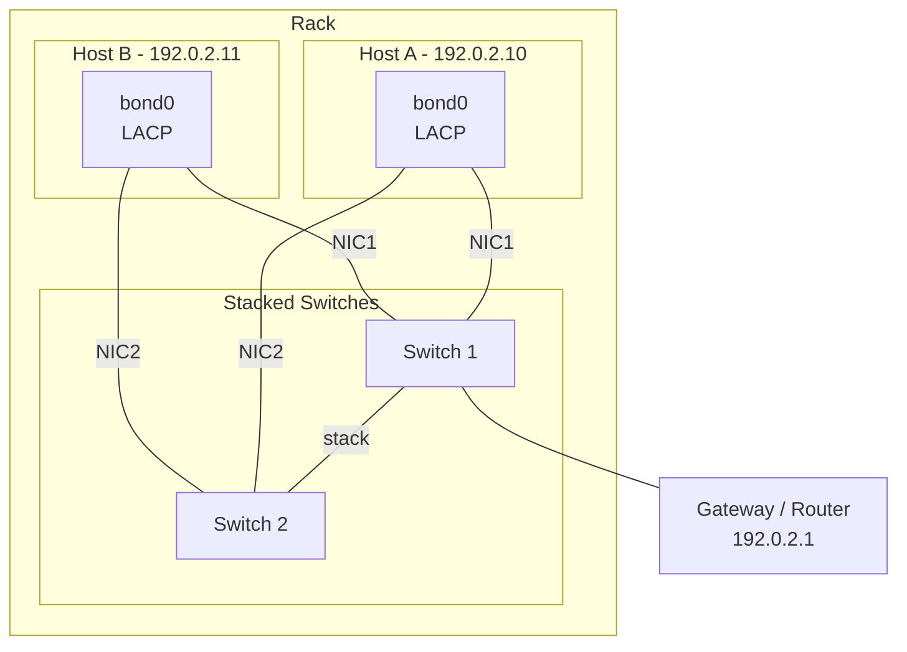
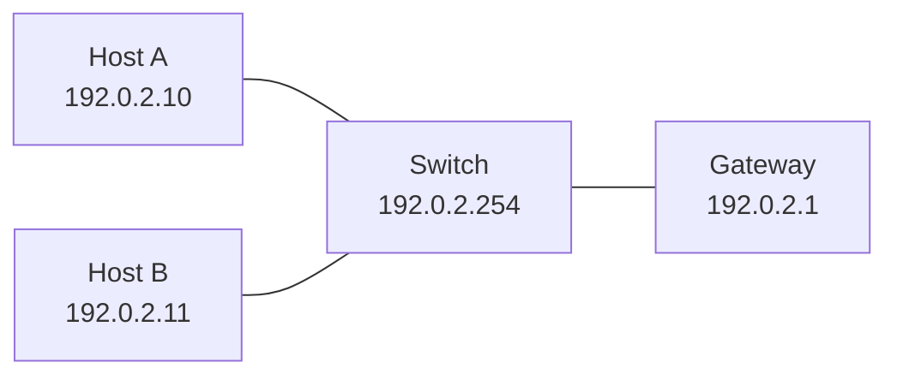
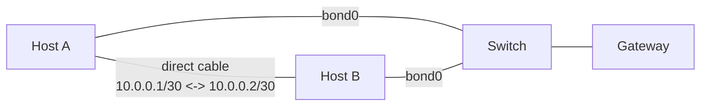

# TwinStor FAQ and operations guide

Questions and procedures for running TwinStor: design choices, failure
walkthroughs, networking, logging and monitoring, troubleshooting, the states
where TwinStor waits for an operator, and maintenance (disk and host
replacement, upgrades, removal).

The case-by-case behaviour reference is [BEHAVIOR.md](BEHAVIOR.md). The
rules every behaviour below follows are listed in the
[README](../README.md#what-happens-when-something-fails): an acknowledged
write is never silently destroyed, an ambiguous state holds and alerts
instead of guessing, decisions use evidence observed on the host itself, and
every incident is logged with an id and names the VMs it touched.

Commands below use the default resource name `twinstor-data` and the default
SR name-label `twinstor`. `twinstor sr show` prints the SR uuid that the
`pool-ha-enable` commands need.

---

## Design

### Why DRBD dual-primary (not primary/secondary)?

Both nodes serve storage locally, so VMs read from the local disk with no
network hop, and writes replicate synchronously. When a node dies there is no
failover delay (the survivor was already serving) and no promote/demote step.

XAPI and SM already activate each LV on one host at a time, so dual-primary is
safe without a distributed lock manager.

### Why iSCSI with multipath, not a VIP?

Each node keeps its own real IP. dm-multipath knows both and prefers the local
path. There is no floating VIP to manage, no gratuitous ARP and no conflict
with XAPI networking: it is the standard iSCSI multipath that XCP-ng already
supports.

### Why delegate fencing to XHA?

XHA already detects node failure, fences (through the Xen hypervisor
watchdog) and restarts VMs (through XAPI). Doing the same in the TwinStor
daemon would create conflicts (double fencing, timing interference). TwinStor
manages storage; XHA manages availability.

### Why dom0, not a VM?

A VM that provides shared storage is a chicken-and-egg problem: you need the
shared storage to protect the VM with HA, but the VM provides the shared
storage. In dom0, TwinStor is up whenever the host is up.

### Why no tiebreaker or third node?

Most two-node HA designs need a third component to avoid split-brain: a
witness node, a quorum disk on shared storage, or an external arbitrator.
TwinStor uses none of these.

A node that cannot reach the network cannot serve clients. TwinStor uses that
as the tiebreaker: the node that can reach the gateway survives, and the
isolated node yields. This is the same approach as VMware vSphere HA's
"isolation response".

When DRBD finds the peer unreachable, it calls the fence-peer handler. The
handler pings the default gateway and any targets in
`/etc/twinstor/ping-targets`:

- **A target answers:** exit 4. DRBD resumes I/O and this node serves.
- **No target answers:** exit 1. I/O stays frozen and the node yields. With
  pool HA armed, XHA cannot write its statefile, its watchdog fires and the
  node self-fences.
- **At promote time**, a node that is still Secondary refuses to outdate a
  peer whose DRBD port accepts connections: the partition has already healed,
  so DRBD reconnects instead. A rejoining node cannot create a dual-master.

Each target gets one `ping -c 1 -W 1`, and two more echoes only if the first
is lost.

#### Comparison with other HA solutions

| Product | Isolation detection | Tiebreaker | Extra infrastructure |
|---------|---------------------|------------|----------------------|
| vSphere HA | Ping gateway (up to 10 targets) | Datastore heartbeat | Shared SAN |
| Pacemaker 2-node | Ping resource (scored) | QDevice on 3rd host | QDevice host |
| Proxmox VE 2-node | Corosync membership | QDevice on 3rd host | QDevice host |
| Hyper-V Failover | Heartbeat only | Cloud/File/Disk Witness | Witness resource |
| LINBIT DRBD 2-node | DRBD quorum | Diskless 3rd node | 3rd node |
| TwinStor | Ping gateway | Gateway reachability | None (uses the existing router) |

#### Comparison with traditional approaches

| Approach | External infrastructure | Fencing | Split-brain prevention |
|----------|-------------------------|---------|------------------------|
| Pacemaker + DRBD | IPMI/BMC required | Remote (must reach the peer's BMC) | Quorum disk or witness node |
| Ceph (2-node) | Arbiter/tiebreaker monitor | Requires a 3rd node | 3rd monitor process |
| XOSTOR (2-node) | 3rd XCP-ng host as arbiter | Through XAPI | DRBD/LINSTOR quorum (3 nodes) |
| TwinStor | None | Self-fencing (Xen watchdog, through XHA) | DRBD fence-peer (the node that reaches the gateway serves); a true split-brain is resolved by DRBD generation lineage |

### Why a single network path? (fate-sharing)

In the default fate-shared mode, replication, the XHA heartbeat and
client/gateway traffic share one physical path (one link or bond). This is a
safety property, not only a simplification.

With one shared path a node is either fully connected or fully isolated.
There is no state where a node loses replication to its peer yet still
reaches the gateway and clients. When a link fails, the affected node loses
the peer, the heartbeat and the gateway at the same moment and yields (it
could not serve clients anyway). The other node keeps serving.

This closes the one steady-state scenario that splits a two-node DRBD pair:
replication down while both nodes still believe they are healthy. That
"both reach the gateway, replication is down, both stay Primary" divergence
requires the replication path to fail independently of the client path,
which only happens when replication has its own link. With a single path it
cannot happen: the replication path and the path that decides survival share
fate.

A dedicated back-to-back replication link brings that independent-failure
case back, so it is supported only as the second mode, arbitrated
(`twinstor setup --direct-ip`). DRBD then runs both paths as an
active-backup pair and the fencing policy is `resource-and-stonith`, which
freezes I/O the moment replication is lost, before any write can diverge.
The fence-peer handler also probes the peer's direct-link IP, but only to
label the outcome in logs and alerts; the survive/yield decision is still
gateway reachability. See
[NETWORK_TOPOLOGY_SAFETY.md](NETWORK_TOPOLOGY_SAFETY.md) for both modes.

### Do the extra layers (iSCSI, tapdisk, DRBD) hurt performance?

They add a bounded overhead. Reads are served locally and reach hundreds of
MiB/s with roughly 150 µs latency inside a VM. Durable writes are bounded by
synchronous DRBD replication (around 300 MiB/s), which is the cost of
two-node redundancy rather than of TwinStor itself. The iSCSI loopback and
tapdisk layers each add on the order of 40 µs per I/O and cap read
throughput, but they are not the dominant factor: writes are bound by
replication, and reads still serve typical VM workloads. The per-layer table
is in [ARCHITECTURE.md](ARCHITECTURE.md), "Performance: order-of-magnitude,
per layer".

---

## Failure scenarios

Walkthroughs of the main failure modes. For every case at a glance, in both
deployment modes, with redundancy and operator actions, see
[BEHAVIOR.md](BEHAVIOR.md).

### 1. Node power loss

- Node A dies.
- XHA on B detects that A is gone after the HA timeout (`ha-config:timeout`:
  120 s fate-shared, 90 s arbitrated, as set by `twinstor setup`).
- XHA's survival rule keeps B. If A is hung rather than dead, its watchdog
  resets it.
- XAPI on B restarts A's protected VMs, using B's local iSCSI target.
- B was never interrupted (it was already serving).
- A reboots, the daemon starts, DRBD reconnects and resyncs the changed
  blocks (bitmap resync).
- Both nodes are back online.

### 2. Network partition

- The network between A and B goes down (for example, a cable pulled on one
  host).
- DRBD detects the peer loss and calls the fence-peer handler on both nodes.
- The decision is gateway reachability, not pool role: the node that can
  still ping a target survives (exit 4, writes continue); the isolated node's
  handler exits 1 (I/O stays frozen, the node yields).
- In arbitrated mode, and in fate-shared freeze mode, I/O froze at the
  disconnect, so the isolated node acknowledged nothing its peer lacks. Freeze
  mode is the default on fate-shared pools where both nodes run 0.7.0 or
  later; see [FATE_SHARED_FREEZE_MODE.md](FATE_SHARED_FREEZE_MODE.md). With
  freeze mode off, the isolated node keeps writing for the few seconds the
  handler takes, and the reconnect is a split-brain that the resolver
  settles (BEHAVIOR.md case 45).
- Isolated node, with pool HA armed: XHA cannot write its statefile (I/O
  frozen), the watchdog fires and the host self-fences (36-82 s in testing).
- Survivor: keeps serving, its VMs are unaffected. If the isolated node was
  the pool master, XHA elects the survivor.
- XHA on the survivor restarts the isolated node's protected VMs.
- The fenced node reboots, DRBD reconnects and resyncs.

### 3. Daemon crash

- DRBD and iSCSI are kernel state; they survive the crash.
- systemd restarts the daemon (`Restart=on-failure`; the unit's
  `WatchdogSec=900` also restarts a daemon that hangs).
- The daemon finds DRBD already Primary and the iSCSI target already running.
- It resumes Online, with no I/O impact.

### 4. Short network flap

Two different physical events look like "a short flap" and they do not
behave the same. What matters is whether the link carrier stays up.

**Packet loss, congestion, STP reconvergence (carrier stays up):**

- DRBD pings the peer every 2 s (`ping-int 2`) and waits 0.5 s for the
  answer (`ping-timeout 5`, in tenths of a second); under I/O a request may
  take `ko-count 3` times the 5 s `timeout`. A short blip that only delays
  TCP is ridden: DRBD stays Connected, with no disconnect and no fence-peer
  run. Total loss on an idle link disconnects within about 2.5 s.
- XHA (HA timeout 120 s fate-shared, 90 s arbitrated) does not trigger
  either.
- No impact.

**Physical carrier drop (cable pull, NIC reset, switch port bounce):**

The TCP session dies the instant the carrier drops, so DRBD disconnects
immediately however short the flap is, and the fence-peer handlers run on
both nodes 2-3 s later. The outcome depends on when the link comes back:

- **Back before the probes run** (a flap of under about 3 s): both nodes
  still reach the gateway. Before deciding, each handler checks the peer's
  DRBD port; when it answers (the flap has already healed), the handler
  waits up to 4 s for DRBD to reconnect. If it does, the blocked writes
  resume through replication: no divergence, no discard, no VM restarts,
  only a stall of a few seconds. If it does not, a fixed tiebreak decides:
  without freeze mode the node with the lower hostname (the keeper) keeps
  serving and the other yields frozen, provided the keeper's iSCSI portal
  answers; in freeze mode the node yields frozen to a peer whose daemon
  answers. A yielding node waits up to 12 s more for the reconnect before it
  freezes. Only a peer that answers on no address (a gray failure) leaves
  both nodes serving, and the split-brain resolver then settles it.
- **Back after the probes but within the XHA timeout:** the side that lost
  its ping targets yielded. In arbitrated mode and in freeze mode its I/O was
  frozen from the disconnect, nothing diverged, and on heal DRBD reconnects
  and the daemon resumes I/O: VMs stall and continue, with no restarts and
  no data loss. With freeze mode off, see scenario 2.
- **Longer than the XHA timeout:** the fencing path (scenarios 1 and 2).

So a very short carrier flap can still cost more than a longer one, when the
reconnect misses the handler's wait. See
[What if a link keeps flapping](#what-if-a-link-keeps-flapping-bad-nic-cable-or-switch-port)
for the runbook.

### 5. Local disk failure

- DRBD sees I/O errors and detaches the disk (`on-io-error detach`).
- The daemon sees the node go Diskless within about a second, enters
  Degraded and raises a priority-1 `twinstor_degraded` alert, but keeps the
  local iSCSI target serving: a diskless DRBD Primary forwards all I/O to the
  peer's disk, so VMs and the XHA statefile see no path change (only higher
  I/O latency on that node). No failover, no freeze, no fencing.
- If the peer is also unavailable (double failure), the target stops so
  initiators fail fast, and the alert says manual intervention is urgent.
- While Degraded, the daemon retries `drbdadm attach` about every 30 s. When
  the device returns (a transient controller fault, a hotplug), it
  re-attaches, resyncs the changed blocks and returns to full redundancy with
  no intervention. The alert is raised again every 24 hours while the node
  stays degraded, so a dead disk is not forgotten. A physically replaced disk
  needs the procedure in
  [How do I replace a failed disk?](#how-do-i-replace-a-failed-disk).
- **A Degraded cluster runs without redundancy.** A second failure (the peer
  node or the peer's disk) loses data.
- Serving through the peer is deliberate. Stopping the local target and
  relying on multipath failover to the peer's path was tested and rejected:
  the failover stalled in-flight I/O long enough for XHA to fence the host,
  turning a disk failure into a host failure.

### 6. Graceful reboot

- VMs are evacuated from this node (standard rolling-update procedure).
- systemd stops the daemon (SIGTERM). The iSCSI target stays up
  (`KillMode=process`) and goes down with the host.
- The node reboots (and updates, if this is a patch reboot).
- The daemon starts, brings DRBD up, promotes and starts the iSCSI target.
- DRBD reconnects to the peer and resyncs the changed blocks.
- Back online.

### 7. Cold start (both nodes boot together)

- Both daemons start independently.
- Each defers its DRBD promote until it has connected to the peer (DRBD
  startup connection wait, `wfc-timeout 90`), so neither comes up as a lone
  Primary.
- DRBD connects and resyncs if needed.
- Both promote to Primary (dual-primary) and start their iSCSI targets.
- XHA starts, sees both hosts alive, and normal operation resumes.

### 8. DRBD split-brain

The fence-peer handler is the first line of defence: on a network partition
it yields the isolated node before writes can diverge (in arbitrated mode and
freeze mode, I/O is frozen from the disconnect). It cannot cover every case,
for example a host-local fault that blocks the replication port while general
reachability survives, so TwinStor also handles a true divergence explicitly.

DRBD is told never to discard a diverged copy on its own. On any split-brain
it disconnects and invokes the `split-brain` handler:

```
after-sb-0pri disconnect;
after-sb-1pri disconnect;
after-sb-2pri disconnect;
```

The daemon then resolves it, loudly, by which copy holds the newer writes
(below), not by which node is the pool master.

### StandAlone recovery: clean rejoin or true split-brain

`StandAlone` happens in two very different situations, and TwinStor tells
them apart instead of treating both as discardable:

- **Clean rejoin** (a node crashed, lost power or rebooted, and served nobody
  while down). A plain `connect` resyncs it from the survivor and nothing is
  lost. This is the common case.
- **True split-brain** (both nodes wrote independently while disconnected).
  DRBD's `split-brain` handler drops a marker at `/run/twinstor/split-brain`.
  Here a blind `--discard-my-data` would roll back writes already
  acknowledged to a running VM, so it is never done blindly.

The reconcile runs after a debounce (`[timers] standalone_grace_secs`,
default 30 s), from the Online loop and from bring-up, so a node that boots
with a non-promotable (`Inconsistent`) replica still heals:

1. If the split-brain marker is absent, the daemon attempts a
   non-destructive `connect`. If it succeeds, it was a clean rejoin and
   nothing was discarded. If DRBD detects a split-brain it disconnects again
   and writes the marker, handled below.
2. If the marker is present, the daemon resolves it by data currency. It
   reads both nodes' DRBD generation UUIDs (from the connection-handshake
   kernel log) and keeps the copy that holds a superset of the committed
   writes: the node that is ahead wins, whatever its pool role. This matters
   because a node that kept serving while its peer was gone stays labelled
   `UpToDate`, while a node that crashed holding the newest writes comes back
   `Consistent`; choosing by disk label or by pool-master role could roll the
   fresher copy back. The generation lineage cannot be misled that way.
   - **Ahead: winner.** Keeps its data, keeps serving, and is the sync
     source.
   - **Behind: loser.** Discards and resyncs from the winner. It loses
     nothing that exists only on its side.
   - **True fork** (both advanced independently, so neither copy is a
     superset of the other): converging must lose one side's writes.
     TwinStor keeps the copy with more un-replicated writes (the smaller
     loss). For a node that crashed while Primary, its activity-log marks are
     discounted first, because DRBD flags every recently used extent at
     restart whether or not it was written during the split. A
     `twinstor_split_brain_diverged` alert names the rolled-back node and the
     approximate volume. The discard is never silent.
   - Only when the generations cannot be read does the daemon fall back to
     the pool-master / keeper election. The answer must then stay identical
     across a 45 s sampling window, so an HA failover in progress settles
     before anything is discarded.
   - **The loser**, however it was chosen, first stops the VMs on that host
     that use the SR and releases their disk handles (the crash boundary, see
     [RECOVERY_CRASH_BOUNDARY.md](RECOVERY_CRASH_BOUNDARY.md)), then stops its
     iSCSI target, then runs `connect --discard-my-data` and resyncs from the
     winner. Its VMs restart on the kept copy: a clean crash, not a rollback
     under a running guest. If the winner is not listening yet, the discard
     offer stays parked (DRBD `Connecting`) so the winner's next reconnect
     takes it; the loser does not cycle disconnect/retry against the
     winner's reconnect timer.
   - **Winner undecidable** (XAPI unreachable, or the sampled answer does
     not stay stable across the 45 s window): TwinStor refuses to discard,
     keeps both copies intact and raises a `twinstor_split_brain` alert for
     an operator decision. It never discards on a guess. See
     [Split-brain recovery by hand](#split-brain-recovery-by-hand).

Every split-brain resolution raises a priority-1 `twinstor_split_brain` XAPI
alert naming what was discarded. During the loser's resync its local iSCSI
target is down; dm-multipath covers the gap through the peer's path
(priority 10, standby) and returns to the local path (priority 50) when the
target restarts.

With pool HA armed the divergence window is bounded: the XHA statefile lives
on the replicated SR, so once replication is cut each node stops seeing the
peer's statefile updates and XHA fences one side within about its timeout
(about 45 s in one hardware test). The resolution path above has been
validated end to end on hardware.

TwinStor favours convergence and self-healing over holding the pool down. A
true both-sides-served split-brain is made rare by layered prevention
(fencing that freezes or yields the isolated side, promote guards, flap
defusal, replication on the direct cable in arbitrated mode) and ended by
XHA fencing one side. The worst case is a loud, crash-consistent rollback of
the loser's writes for as long as both sides served (as long as a
replication-only cut lasts, or until XHA fences a side: 197 s in one test
with HA armed), with the loser's VMs restarted on the winner. The layer by
layer analysis is in
[NETWORK_TOPOLOGY_SAFETY.md](NETWORK_TOPOLOGY_SAFETY.md), "The divergence
budget".

### Can TwinStor lose acknowledged writes?

Yes, in one specific and rare situation, and no synchronously replicated
two-node system can promise otherwise. This is the CAP trade-off: while the
two nodes are partitioned you can have consistency or availability, not
both, and TwinStor is built to keep the workload available (automatic
healing and HA restarts). The only outcome where converging must drop an
acknowledged write is a **true fork**: both nodes kept writing while they
could not see each other, so neither copy contains the other's writes and
there is nothing to merge. One side's writes have to go.

TwinStor makes that outcome rare, small and loud:

- **Rare.** Layered prevention keeps both nodes from writing while split:
  fencing that freezes or yields the isolated side, promote guards,
  `suspend-io` on the isolated side, flap defusal, and the XHA statefile,
  which fences one side once the split outlasts the HA timeout. Most real
  failures are not forks at all: one node crashed or rebooted and served
  nobody while down, which resyncs with no loss.
- **Small.** When a fork does happen, the winner is chosen by DRBD
  generation lineage: the copy that holds the newer writes wins, not the one
  that happens to be pool master, and on a true fork the side with more
  un-replicated writes is kept, so the rollback is the smaller of the two,
  limited to the un-replicated window (seconds).
- **Loud.** A fork never resolves silently. A priority-1
  `twinstor_split_brain_diverged` alert names the rolled-back node and the
  approximate volume discarded, so you know which VMs to check.

**To reduce it further:** a fork requires the same data to take writes on
both hosts during a partition. For a workload that cannot tolerate any loss,
keep the VMs that share its data anti-affine (XO anti-affinity groups, or a
hard host pin), so a single host loss can only take down one side, which is
the clean-rejoin case, not a fork. For the mechanism, see
[CONVERGENCE.md](CONVERGENCE.md), "Freshness-first: the generation-lineage
override".

XHA chooses which host to fence by its own heartbeat and statefile
arbitration, not by which host is the XAPI pool master, so the fenced host is
not necessarily the split-brain loser. In one rare case (a fault that blocks
only the DRBD replication port while both hosts still reach their ping
targets, for longer than the XHA statefile timeout of 120 s fate-shared or
90 s arbitrated), both hosts can self-fence in sequence a few minutes apart:
two reboots instead of one. This costs extra VM downtime but no data: the
resolution waits out the instability before it discards anything, and the
copy it keeps is still chosen by the rules above.

---

## Network

### Custom ping targets

By default the fence-peer handler pings the default gateway. For more
reliability, add targets to `/etc/twinstor/ping-targets`, one IP per line
(`twinstor setup --ping-target <ip>`, repeatable, writes the same file):

```
# /etc/twinstor/ping-targets
192.0.2.254     # switch management IP
10.0.0.1        # secondary router
```

The logic is "any of N", as in vSphere HA: if any target answers, the node is
considered connected and survives. A single target being briefly unreachable
(a router reboot) then does not make a node yield.

### Prerequisites

**Replication and the ping targets must share one physical path** in
fate-shared mode. The check assumes "if I can reach a ping target, my network
is up". For a dedicated replication link, use arbitrated mode
(`twinstor setup --direct-ip`), which is designed for that topology. Never
put the direct-link IP in `ping-targets`: an isolated node could still reach
its peer over the direct cable and wrongly conclude that it can serve
clients.

### Fence-peer coverage

| Scenario | Node losing the peer | Gateway | Action | Result |
|----------|----------------------|---------|--------|--------|
| Non-master power loss | Master | Reachable | Survive | Master continues, XHA restarts the VMs |
| Master power loss | Non-master | Reachable | Survive | Becomes the new master |
| Non-master cable pull | Non-master | Unreachable | Yield (frozen); self-fence with HA armed | Master unaffected |
| Master cable pull | Master | Unreachable | Yield (frozen); self-fence with HA armed | Non-master takes over |
| Packet loss with carrier up (short) | Neither | n/a | No fence-peer run | DRBD stays Connected, transparent |
| Carrier flap shorter than the handler | Both | Reachable again | Wait up to 4 s for the reconnect, then the tiebreak (scenario 4) | Usually no divergence |

### Network architecture

#### Bonded NICs on stacked switches



Each host has a bond (LACP or active-backup) with one NIC on each switch, and
the two switches are stacked into one logical switch. This gives:

- **Link redundancy:** one NIC or one switch can fail without losing
  connectivity.
- **DRBD replication over the bond:** full bandwidth, no dedicated link.
- **VLANs (optional):** management, VM traffic and storage can be separated
  on VLANs over the same bond, for example DRBD and iSCSI on a storage VLAN
  and management on another.
- **Fence-peer target:** the gateway (192.0.2.1). With stacked switches, both
  hosts lose the gateway together only on an upstream failure.

A stack can split (a stack-link failure, or a member rebooting during a
firmware update) so that each member still forwards to the gateway but the
hosts lose each other. That is the case fate-shared mode cannot see; read
[NETWORK_TOPOLOGY_SAFETY.md](NETWORK_TOPOLOGY_SAFETY.md), "Stacked switches,
stack split", and use arbitrated mode if your stack can split this way.

#### Example IP scheme

| Network | VLAN | Host A | Host B | Gateway |
|---------|------|--------|--------|---------|
| Management | 10 | 192.168.10.10 | 192.168.10.11 | 192.168.10.1 |
| VM traffic | 20 | (bridge) | (bridge) | - |
| Storage/DRBD | 30 | 192.168.30.10 | 192.168.30.11 | - |

Here DRBD and iSCSI use the storage VLAN (192.168.30.x), and the fence-peer
handler pings the management gateway (192.168.10.1), which proves the host
can reach the outside world. VLANs that share physical links share their
fate; a fault that drops only the storage VLAN splits replication while both
hosts still reach the gateway, which the split-brain resolver then has to
settle (NETWORK_TOPOLOGY_SAFETY.md, "Heartbeat and fence target on different
paths").

#### Minimal deployment (single switch, no VLANs)



Everything is on one flat network: DRBD, iSCSI, management and VM traffic
share the same interface, and the fence-peer handler pings the gateway. This
suits small offices and edge sites with simple networking.

#### Arbitrated deployment (direct link between the hosts)



A direct cable (or a second, dedicated switch) between the hosts carries DRBD
replication by default, so synchronous writes and resyncs stay off the
switch and a degrading switch path does not touch replication. The switch
path is the automatic fallback: if the cable or its NIC fails, DRBD moves to
the switch path and stays Connected, the daemon raises a
`twinstor_replication_fallback` alert (after 2 minutes on the fallback), and
it moves replication back to the cable once the cable is stable again.

A whole-switch outage is different: both hosts lose the gateway and the XHA
heartbeat. In arbitrated mode each host learns over the direct link that its
peer cannot reach the gateway either, disables HA locally after about 15 s
to suppress the XHA fence, and keeps its VMs running (unreachable to clients
until the switch returns); HA is re-armed automatically afterwards. See
[After a full network outage](#after-a-full-network-outage-storage-healed-but-vms-did-not-restart).
The survive/yield decision of the fence-peer handler is always gateway
reachability, whichever paths are up.

---

## Logging

The daemon logs to `/var/log/twinstor.log`, with timestamps in the host's
local time (matching the XCP-ng system logs). Every line also carries its
source file and line. The shipped logrotate config keeps 14 daily rotations
(`copytruncate`, compressed, the newest rotation left uncompressed). CLI
commands (`status`, `setup`, ...) write their diagnostics to stderr, so
`status --json` on stdout stays parseable.

```bash
tail -f /var/log/twinstor.log              # follow live
```

Debug lines are not written by default. To get them on one node, add
`Environment=RUST_LOG=twinstor=debug` to the unit (`systemctl edit
twinstor`), restart the daemon on that node only, and remove the override
afterwards. Do not run a second `twinstor daemon` in a terminal while the
service is running.

The fence-peer and split-brain handlers log separately to
`/var/log/twinstor-fence-peer.log` and to syslog (tag `twinstor`). That file
is rotated weekly, 4 rotations kept.

[LOG_REFERENCE.md](LOG_REFERENCE.md) explains how to read both logs: the
fields every line carries, the lines to look at first, the fence-peer verdict
ids, and every `heal_event` name.

### Reading heal episodes in the logs

Whenever the daemon's heal machinery engages, it mints an **episode id** and
logs `heal_event="episode_open"` with an identifier made of the class and the
Unix time it opened, for example `splitbrain-1792571204`, `limbo-...`,
`readmission-...`, `failback-...`. Every later line of the incident is
prefixed `ep{id=...}:` until `episode_close` records the outcome. Each node
mints its own id. To reconstruct an incident:

```
grep splitbrain-1792571204 /var/log/twinstor.log
```

The class names the code path that owns the episode. A clean rejoin opens no
episode, so an id in the logs always means heal machinery ran.

### Log levels

| Level | What | When to use |
|-------|------|-------------|
| ERROR | Data-affecting events | Disk failure, iSCSI failure on disk error |
| WARN | Transient failures, fallback behaviour | DRBD status check failed, PBD plug retry, XAPI unavailable |
| INFO | Every action and state change (default) | State transitions, DRBD changes, commands, heartbeat |
| DEBUG | Every health tick, command stdout/stderr | `RUST_LOG=twinstor=debug` for troubleshooting |

### Log examples

The examples below are shortened: the timestamp, module and source location
are left out, and some lines carry more fields than shown.

**Normal startup (both nodes boot):**

```
INFO  twinstor starting version="0.7.1" node=node-a peer=node-b
INFO  try_go_online: DRBD resource not started, running drbdadm up
INFO  bringing DRBD resource up resource=twinstor-data
INFO  try_go_online: DRBD status after up role=Secondary disk=UpToDate conn=Connecting
INFO  try_go_online: DRBD still Connecting, deferring promote to let the peer connect ceiling_secs=100
INFO  try_go_online: promoting to Primary
INFO  promoting to primary resource=twinstor-data
INFO  try_go_online: starting iSCSI target
INFO  iSCSI target already configured, skipping setup
INFO  state transition from=Init to=Online
INFO  plug_and_multipath: starting iSCSI discovery and PBD setup
INFO  plug_and_multipath: waiting for XAPI
INFO  plug_and_multipath: XAPI ready waited_secs=4
INFO  plug_and_multipath: discovering iSCSI target target="192.0.2.10"
INFO  plug_and_multipath: discovering iSCSI target target="192.0.2.11"
INFO  plug_and_multipath: reconfiguring multipathd
INFO  multipath: local path preferred local_host="3" remote_host="4"
INFO  plug_and_multipath: checking for unplugged PBDs
INFO  plug_and_multipath: plugging PBD pbd="abc12345-..." attempt=1
INFO  plug_and_multipath: PBD plugged pbd="abc12345-..."
INFO  DRBD connection state changed from=StandAlone to=Connected
INFO  peer connected, replication active
INFO  heartbeat state=Online drbd_conn=Connected disk=UpToDate peer_disk=Some(UpToDate)
  ... (the heartbeat line repeats every 5 minutes while healthy) ...
```

**node-b power loss and recovery, on node-a (the survivor):**

```
INFO  DRBD connection state changed from=Connected to=Connecting
INFO  peer disconnected
INFO  DRBD peer disk state changed from=UpToDate to=Unknown
INFO  heartbeat state=Online drbd_conn=Connecting disk=UpToDate peer_disk=None
  ... (XHA fences node-b, XAPI restarts its VMs on node-a) ...
  ... (node-b reboots, its daemon starts, DRBD reconnects) ...
INFO  DRBD connection state changed from=Connecting to=Connected
INFO  peer connected, replication active
INFO  DRBD peer disk state changed from=Unknown to=Inconsistent
INFO  DRBD peer disk state changed from=Inconsistent to=UpToDate
INFO  heartbeat state=Online drbd_conn=Connected disk=UpToDate peer_disk=Some(UpToDate)
```

**Local disk failure:**

```
INFO  DRBD disk state changed from=UpToDate to=Diskless
ERROR local disk failed; serving through the peer (DRBD diskless), target stays up
INFO  state transition from=Online to=Degraded
INFO  XAPI alert sent alert=twinstor_degraded
  ... (VMs keep running, I/O forwarded to the peer's disk; the target never stops) ...
  ... (the device returns, or the disk is replaced and re-attached) ...
INFO  DRBD disk state changed from=Diskless to=Inconsistent
INFO  local disk back, going online
INFO  try_go_online: storage not ready to serve, holding off iSCSI (retrying each tick, logged on change) readiness="not-ready" reason="local disk Inconsistent, not UpToDate (still converging/syncing)"
  ... (full resync from the peer) ...
INFO  DRBD disk state changed from=Inconsistent to=UpToDate
INFO  state transition from=Degraded to=Online
```

**Split-brain resolved on the losing node:**

```
INFO  DRBD connection state changed from=Connected to=StandAlone
INFO  peer disconnected
  ... ([timers] standalone_grace_secs debounce, default 30 s) ...
INFO  DRBD StandAlone past grace period, attempting non-destructive reconnect
INFO  split-brain detected during reconnect, switching to safe resolution
WARN  resolving DRBD split-brain (both nodes wrote independently while disconnected)
WARN  split-brain: resolving as the loser, discarding local diverged writes and resyncing from the winner
  ... (loser_crash_boundary lines: the VMs on this host that use the SR are stopped) ...
INFO  split-brain: stopping iSCSI so VMs restart on the winner
WARN  drbd connect --discard-my-data (discarding local diverged writes) resource=twinstor-data
INFO  split-brain: reconnected, resyncing from the winner waited_secs=1
INFO  split-brain: recovery complete
INFO  DRBD peer disk state changed from=Unknown to=UpToDate
INFO  peer connected, replication active
```

When the lineage cannot be read and XAPI cannot name the pool master, the
daemon logs instead:

```
ERROR split-brain: cannot determine pool master; refusing to auto-discard, alerting and retrying
```

and keeps both copies until XAPI answers.

---

## Monitoring

What an external monitoring system should watch, per node. Separately, the
daemon publishes `twinstor-*` keys in XAPI `other_config` (per-host health,
and the pool master's view of the SR's redundancy and resync state) for Xen
Orchestra to show storage health and pace rolling updates; Xen Orchestra
support for reading them is planned. The probes below work with any monitor
today.

### Primary probe: `twinstor status --json`

One-shot, works whether or not the daemon runs, safe to poll (every 30-60 s
is fine). Abridged output:

```json
{
  "version": "0.7.1",
  "peer_version": "0.7.1",
  "reboot_guard": "armed",
  "resource": "twinstor-data",
  "topology": "fate-shared",
  "host": {"local": "node-a", "peer": "node-b", "pool_master": "node-a",
           "ha_enabled": true, "ha_rearm_pending": false},
  "daemon": true,
  "readiness": {"status": "ready", "reason": ""},
  "drbd": {"role": "primary", "disk": "uptodate", "connection": "connected",
           "peer_role": "primary", "peer_disk": "uptodate"},
  "sync": null,
  "replication_path": null,
  "failback": null,
  "iscsi": true,
  "capacity_pct": 42,
  "multipath": "...",
  "path_health": "ok",
  "auto_heal": null,
  "config_version": {"deployed": 6, "binary": 6},
  "backing_disks": [{"disk": "/dev/disk/by-id/...", "write_cache": "disabled"}]
}
```

- `path_health` is `"ok"` when healthy, a reason string otherwise.
- `auto_heal` is the heal-state object during an auto-heal episode, `null`
  otherwise.
- `config_version` compares the deployed DRBD resource file with what the
  binary generates (`null` if unknown).
- `replication_path` (arbitrated mode) is `{"active": "direct"|"switch",
  "peer": ..., "fallback": true|false}`; `null` in fate-shared mode.
- `reboot_guard` is `armed`, `off` (disabled in config) or `not-armed` (the
  reboot-drain unit is not enabled and active).
- `capacity_pct` is the SR's physical utilisation (`null` if XAPI did not
  answer).

Suggested rules:

| Condition | Severity | Meaning |
|-----------|----------|---------|
| `daemon == false` | critical | Daemon not running (systemd should restart it; investigate if it persists) |
| `readiness.status == "not-ready"` | critical | The node cannot serve; `reason` says why (converging, disk failed, toolstack down) |
| `readiness.status == "serving-without-redundancy"` | warning | One healthy copy only; a second failure loses data. Normal during a resync or a peer reboot: alert if it persists more than 15 min |
| `readiness.status == "degraded-paths"` | warning | Local path stack impaired but still serving; the daemon heals it itself. Alert if it persists |
| `iscsi == false` while `readiness.status == "ready"` | critical | The target should be up and is not |
| `iscsi == null` | warning | `targetcli` did not answer within its bound (typically wedged on failed backing disks); the target may still be exported. Not a confirmed outage: check `readiness` and `drbd` |
| `sync != null` | info | Resync in progress (`percent`, `eta`), expected after any rejoin |
| `drbd == null` | critical | `drbdadm status` itself failed |
| `host.ha_enabled == false` | warning | Pool HA is off: no automatic VM restart and no fencing (also covered by the `twinstor_ha_disarmed` alert) |
| `replication_path.fallback == true` | warning | Arbitrated: replication runs on the switch path; check the direct cable |
| `reboot_guard != "armed"` | warning | The reboot-safety drain will not hold a reboot during a resync |

### XAPI alerts (pool-level, visible in Xen Orchestra)

| Message name | Priority | Meaning |
|--------------|----------|---------|
| `twinstor_split_brain` | 1 | Split-brain detected and/or resolved, or held for an operator decision; diverged writes may have been discarded. Read the body and check the VMs it names |
| `twinstor_split_brain_diverged` | 1 | True fork: both copies took writes; names the rolled-back node and the approximate volume discarded |
| `twinstor_degraded` | 1 | Local disk failed, or the peer has not been a healthy redundant copy for longer than `standalone_grace_secs` (30 s); the cluster serves without redundancy. Raised again every 24 h |
| `twinstor_backing_missing` | 1 | The configured backing device path no longer exists (replaced disk, recreated array); fix with `twinstor replace-backing` |
| `twinstor_ha_disarmed` | 1 | Pool HA off for 30 min or more; dual-primary runs without its fencing safety net |
| `twinstor_flapping_link` | 1 | 3 split-brain episodes (or 5 disconnects) within 15 min; follow the flapping-link runbook |
| `twinstor_ha_wedge` | 1 | Dual-master wedge detected; the body carries the recovery |
| `twinstor_replication_fallback` | 1 | Arbitrated: replication left the direct link and runs on the switch path; check the cable. Failback is automatic |
| `twinstor_cannot_go_online` | 1 | The node has not reached a serving state for 5 min; the body names the cause (kernel module, config, backing device, peer) |
| `twinstor_no_tiebreaker` | 1 | The fence-peer probe set (gateway plus ping targets) is empty, or every target has been unreachable for about 30 min; any replication interruption would then freeze this node |
| `twinstor_peer_daemon_down` | 1 | The peer's daemon has not stamped liveness for 15 min while its host looks healthy; its safety layer is absent |
| `twinstor_host_held_isolated` | 1 | This host has been disabled for 5 min with healthy storage but an unreachable gateway, so it is not auto-enabled |
| `twinstor_reboot_unsafe` | 1 | Raised at boot: the previous reboot went ahead while this host held the only up-to-date copy (cap reached, peer unreachable, or override) |

When one of these fires and you need to escalate, run
`twinstor support-bundle` on both nodes and attach both files: it packages
the logs, the redacted config, and a DRBD / iSCSI / multipath / XAPI / host
snapshot for offline analysis.

Query them with `xe message-list name=<name>`, or forward them from Xen
Orchestra.

### Pool-level checks

- `xe pbd-list sr-name-label=twinstor currently-attached=false --minimal`
  must be empty; an unplugged PBD means a host lost its storage path.
- `xe host-list enabled=false --minimal`: a host disabled for more than a few
  minutes blocks XHA VM restarts. XAPI keeps a host disabled when any PBD
  failed to plug at boot; fix the SR, then `xe host-enable`.
- `xe pool-param-get uuid=<pool> param-name=ha-enabled` must be `true` in
  production (also covered by the `twinstor_ha_disarmed` alert).

### Log patterns worth alerting on

- `ERROR` in `/var/log/twinstor.log`: disk failures, an undecidable
  split-brain (`refusing to auto-discard`).
- In `/var/log/twinstor-fence-peer.log`, the `verdict=<id> exit=1` lines: a
  node yielded (for example `verdict=isolated_yield` when it found itself
  isolated). `exit=4` lines are the survival verdicts. The daemon logs the
  same verdicts as `fence_peer_verdict`. LOG_REFERENCE.md lists every
  verdict id.

---

## Troubleshooting

### After a full network outage, storage healed but VMs did not restart

This applies to **fate-shared** pools. In arbitrated mode a total switch
outage does not fence: each host reads over the direct-link beacon that its
peer cannot reach the gateway either, sees that neither side can serve
clients, suppresses its XHA statefile fence and keeps its VMs running
through the outage (the guest network is on the dead switch, so the VMs are
unreachable until it returns), then re-arms HA automatically.

The symptom: a total switch outage (every host loses the network at once,
for example switches not on the UPS) in a fate-shared pool. Both hosts fence
and reboot, the network returns, storage reconverges cleanly, but no VMs
start, and `twinstor status` on the pool master says
`toolstack not converged (XAPI host enabled=false)`.

What happened: the master's XAPI initialised while storage was still
converging, failed its boot-time enable sequence and left the host disabled
(maintenance mode). XAPI does not retry the enable by itself, and HA does not
place VMs on a disabled host. The storage layer is fine; this is toolstack
aftermath, and whether you hit it is a boot-timing race, so one host may show
it while the other is clean.

The daemon handles this itself. A host found disabled while storage is
healthy and without XO's operator maintenance marker
(`other-config:MAINTENANCE_MODE=true`) is enabled automatically after
5 minutes (at most once an hour). It is not enabled while its gateway is
unreachable (it would run VMs that clients cannot reach); that case raises
`twinstor_host_held_isolated`.

To clear it by hand, take the host out of maintenance mode in Xen
Orchestra, or on the affected host:

```
xe host-enable host=<hostname>
```

HA then restarts the protected VMs by itself.

Protected VMs that stay halted after XAPI's bounded HA restart attempts ran
out are restarted by the daemon too (`[ha] restart_halted_protected_vms`,
default on):

- A halt is restarted only when it traces to an incident (storage degraded,
  a heal episode open, or an XAPI outage in the observation window). A halt
  first seen between two healthy scans is treated as an operator action and
  only alerted.
- XAPI must still count the VM as protected (`ha-always-run` true). XAPI
  clears that flag when you shut a VM down through XAPI, and, in fate-shared
  freeze mode, when the guest shuts itself down; such a VM is never started.
- A VM the split-brain crash boundary marked `twinstor-disks-suspect` is
  never started.
- Per VM: at most one start an hour; a failed start is retried after a
  back-off (one minute, doubling up to 30 minutes), with one alert after 5
  failures.

Other halted VMs with a restart priority only raise an alert. To keep a
protected VM down permanently, clear its `ha-restart-priority`.

### A GPU or PCI-passthrough VM did not fail over on a host failure

A VM with a PCI passthrough device (GPU, NIC, HBA, a passed-through NVMe) is
pinned to the host that holds that device: it is not agile and cannot run
anywhere else. **Do not HA-protect it.** XHA judges agility from storage and
memory only and ignores PCI passthrough, so it admits such a VM to the
failover plan (`ha-overcommitted` stays `false`) and then, on a real host
failure, tries to restart it on the survivor, where the device does not
exist. The start fails and the VM stays halted for the whole outage,
recovering only when its own host comes back. The agile VMs on the same host
fail over normally; only the passthrough VM is lost. This is an XHA
limitation that you avoid by configuration.

**Configuration: auto-start on its own host, no HA:**

```
xe pool-param-set uuid=<pool> other-config:auto_poweron=true   # once, pool-wide
xe vm-param-set    uuid=<vm>   other-config:auto_poweron=true
xe vm-param-set    uuid=<vm>   ha-restart-priority=             # empty = not HA
```

The VM can only ever run on its device host, so restarting it there at boot
is the only possible recovery, which is what `auto_poweron` does. The
pool-level flag is required too, or the per-VM flag is ignored. See
[VM_PLACEMENT_SAFETY.md](VM_PLACEMENT_SAFETY.md) for the reasoning.

### A fenced host came back stuck in maintenance ("invalid host UUID")

After a host is isolated and fenced, it can come back stuck in maintenance
(disabled), with pool operations failing on an "invalid host UUID" that is
nonetheless listed in `xe host-list`. Storage can be fully healthy (DRBD
resynced, both UpToDate, no split-brain) and the host still does not
re-enable.

**First, confirm it is stuck rather than settling.** A returning host is
briefly `enabled=false` for a few seconds while XHA re-admits it to the
liveset and xapi finishes starting; that is normal. In testing, a single
clean isolation heals itself within a few minutes (sometimes after one or two
extra XHA fence reboots). The wedge is a host that stays disabled, or keeps
failing `xe` commands, for many minutes with no progress. Watch it for about
5 minutes first:

```
watch -n5 'xe host-list params=hostname,enabled,host-metrics-live'
```

If it converges by itself, do nothing. If it stays stuck, recover it.

The condition follows a prolonged or repeated partition (for example, five
split-brains over 48 minutes with manual reconnects), not a brief blip.
Find out which case you are in by asking **both** hosts who the master is:

```
# run on each host
xe pool-list params=master --minimal ; cat /etc/xensource/pool.conf
drbdadm cstate twinstor-data
```

**Case 1: one master, the other host stuck disabled, DRBD still
Connected/UpToDate.** The master's `xhad` liveset is stale. Clear it from the
master: `xe pool-ha-disable` (if it hangs, `xe host-emergency-ha-disable
--force`, or reboot the master), confirm the host shows `enabled=true` with
its PBD plugged, then re-arm with
`xe pool-ha-enable heartbeat-sr-uuids=<SR uuid> ha-config:timeout=120` (90
in arbitrated mode; the SR uuid is in `twinstor sr show` or
`xe sr-list name-label=twinstor --minimal`).

**Case 1b: `xe` says "The server could not join the liveset because the HA
daemon failed to start", possibly on both hosts, while storage is fine.**
This is the join deadlock after a fence storm: two staggered HA-daemon
restarts each keep the other's stale liveset claims fresh (claims age out
only after 60 s), so host A waits for an acknowledgement only B as a member
could give, while A's own claim that B is a member blocks B from starting;
both time out after 120 s and spoil each other's retry. The daemon detects
this signature and, unless `[ha] readmission_assist = false`, recovers it
(at most once an hour): it quiesces both HA daemons for more than 90 s (every
stale claim ages out), then re-arms once, with the timeout preserved
(`pool-ha-enable` starts both `xhad`s together, so they bootstrap from an
empty liveset). The manual form of the same recovery: on both hosts
`xe host-emergency-ha-disable --force`, wait 90 seconds, then from the master
`xe pool-ha-disable` and re-arm with the explicit `ha-config:timeout=` form.
If the daemon alerts "storm still active" instead, fix the flapping link
first: every re-formed liveset collapses again while the statefile path keeps
failing.

**Case 2: both hosts say `master`, `pool-list` disagrees depending on which
host you ask, and `drbdadm cstate` is `StandAlone` on both.** The pool has
split into two masters: the control plane and the storage are both
split-brained. With two masters, the fallback election makes each node elect
itself and neither discards, so DRBD can stay `StandAlone` indefinitely.
**Toggling HA does not fix this, and toggling HA during a partition can be
what creates the second master.**

**Recommended recovery: restart the spurious master's toolstack.** The
spurious second master is the host that rebooted during the partition and
runs no VMs (the survivor kept serving). On that host:

```
xe-toolstack-restart
```

On restart xapi finds that the survivor is still master and demotes this host
to a member of the survivor's pool, with HA left armed: no
`pool-emergency-reset-master`, no HA disable, no reboot, so no HA membership
mismatch. The daemon then discards this host's diverged copy and resyncs from
the survivor; DRBD is back to Connected/UpToDate within 2-3 minutes. Confirm
there is exactly one master (`xe pool-list params=master`). The daemon does
this itself when the spurious master is freshly booted and runs no VMs, so
usually you only watch it happen.

**Fallback (manual collapse)** when both hosts run VMs (so neither is safe to
demote automatically), the peer runs an older release, or the toolstack
restart does not converge. The winner is the host running the live VMs and
holding the data to keep:

```
# 0. Both hosts: stop the daemon so it stops acting
systemctl stop twinstor
# 1. Winner (true master): disable HA (--force or a reboot if it hangs)
xe pool-ha-disable
# 2. Loser: make it a member of the winner's pool
xe pool-emergency-reset-master master-address=<winner-ip>
# 3. Winner: pull the member back; confirm exactly one master, both live
xe pool-recover-slaves
xe host-list params=hostname,enabled,host-metrics-live
# 4. Both: restart the daemon. With one master again the resolver works:
#    the loser discards its diverged copy and resyncs from the winner.
rm -f /run/twinstor/split-brain ; systemctl start twinstor
drbdadm status twinstor-data        # watch for Connected, UpToDate/UpToDate
# 5. Winner: re-arm HA with the explicit timeout (a bare enable falls back
#    to XAPI's default, 60 s on XCP-ng 8.3)
xe pool-ha-enable heartbeat-sr-uuids=<twinstor SR UUID> ha-config:timeout=120   # 90 arbitrated
```

In testing, 5 repeated isolation cycles drove the pool into dual-master plus
DRBD split-brain; an HA disable/enable did not clear it, and the sequence
above did (DRBD reconverged about 90 s after the daemons restarted). Acting
only on the returned host (reintroducing it, rebooting it) does not help: the
authority is on the master. For the mechanism, and why it is a limitation of
XHA on replicated storage, see "Recovery after a fence: the XHA re-admission
wedge" in [NETWORK_TOPOLOGY_SAFETY.md](NETWORK_TOPOLOGY_SAFETY.md).

### Storage is healthy but VMs will not start: stale locks or an HA-state disagreement

After a rough incident (a site blackout, a run of repeated fences), the pool
can be stuck in a pure toolstack knot while storage is healthy throughout
(DRBD Connected, both UpToDate, no split-brain), with one or both of:

- the member's XAPI refuses to (re)join with **"pool has HA enabled but this
  server has HA disabled"**, which also blocks its static-VDI attach and
  therefore `xhad`;
- **every** VM start fails pool-wide with `SR_BACKEND_FAILURE_46` /
  `MAP_DUPLICATE_KEY` naming an `activating` flag: stale locks left by VM
  starts that died mid-activation. Plain `xe` cannot remove them (that
  `sm-config` key is read-only), and a toolstack restart does not clear them.

Both are toolstack aftermath, not a storage fault.

**Start with `twinstor doctor`.** Without options it is read-only: it reports
both knots and the safety gates below. `twinstor doctor --fix` clears them,
only when every gate passes and you confirm each action; it defers to the
automatic recovery and does not interrupt one in progress.

**Before any manual step, confirm the automatic recovery is not already
handling it.** These are the same gates the daemon and `doctor` apply;
skipping them risks interrupting a recovery that was seconds from finishing.
Proceed only if all of these hold:

1. **Storage is quiescent.** On both hosts `drbdadm status twinstor-data`
   shows Connected, `UpToDate/UpToDate`, no `SyncSource`/`SyncTarget` resync
   and no split-brain. If storage is still healing, the daemon is busy and
   this is not the knot: wait.
2. **The daemon is not mid-heal.** `twinstor status` shows no active heal
   episode (an HA re-arm pending, a lock sweep, and so on). If it does, let it
   finish.
3. **It has been stuck a while.** The condition has persisted unchanged for
   more than about 10 minutes. The daemon sweeps stale `activating` locks
   itself and alerts again on the HA disagreement; a younger stall often
   clears without you.
4. **Prefer the daemon.** If you stopped or masked the daemon during
   recovery, automatic healing is not coming, but you may also be in the
   middle of a manual procedure. Consider starting it again first.

If any gate fails, stop and let the automatic path run. If all hold, clear
the knot you are hitting.

**The HA-state disagreement:** reset it at the pool level from the healthy
master (a host-level toolstack restart does not clear it):

```
# on the pool master
xe pool-ha-disable
xe pool-ha-enable heartbeat-sr-uuids=<twinstor SR UUID> ha-config:timeout=120   # 90 arbitrated
```

**The stale `activating` flags:** remove them through XenAPI (plain `xe`
cannot), clearing only a bare lock (an `activating` key with no `host_*` key:
a half-acquired leftover, not an activation in flight), then start the VMs
normally:

```
# on the pool master (dom0)
python3 - <<'PY'
import XenAPI
s = XenAPI.xapi_local(); s.login_with_password('root', '')
try:
    for vdi in s.xenapi.VDI.get_all():
        sm = s.xenapi.VDI.get_sm_config(vdi)
        if 'activating' in sm and not any(k.startswith('host_') for k in sm):
            s.xenapi.VDI.remove_from_sm_config(vdi, 'activating')
            print('cleared', s.xenapi.VDI.get_uuid(vdi))
finally:
    s.xenapi.session.logout()
PY
xe vm-start uuid=<vm>    # now succeeds
```

You will usually need neither step: the daemon clears stale `activating`
locks itself (on the master, only the bare-lock signature above) and alerts
on the HA disagreement. The manual steps are the fallback for when the
daemon is stopped or masked, or has not cleared the knot within the window
above.

---

## When TwinStor waits for you: the operator decision points

Almost everything heals itself. The exceptions are states where acting
automatically would mean guessing with your data or overriding your intent:
there, TwinStor holds safely, alerts, and waits. The table is the complete
list. In every case doing nothing is safe; the hold persists until you
decide.

| State | How you will know | Your decision | Procedure |
|---|---|---|---|
| Split-brain, winner undecidable | `twinstor_split_brain` alert saying an operator decision is needed; `twinstor status` shows `undecidable` | Which copy is authoritative | On the other node only: `twinstor discard-and-resync` (see [Split-brain recovery by hand](#split-brain-recovery-by-hand) below). Both copies stay intact until you act |
| Both nodes yielded to each other (mutual yield) | Both nodes show the "split-brain loser is holding down" alert; neither serves | Which node survives | On the chosen survivor: remove its yield markers (`rm /run/twinstor/fence-yielded /var/lib/twinstor/yield-loser-latched`); it promotes and the peer resyncs from it |
| Split-brain wedge: both nodes hold as the loser and refuse each other's discard | `twinstor_split_brain` alert "split-brain wedge" after 5 minutes; `twinstor status` shows `sb_wedge` on both; neither serves | Which copy wins (normally the node that did not yield, never one whose disk is not UpToDate) | On the chosen winner only, follow the alert's numbered steps: `systemctl stop twinstor`; check `drbdadm -d adjust <res>` prints only `drbdsetup connect`/`new-path` lines (otherwise stop and get support); `drbdsetup del-peer <res> <peer-node-id>`; `drbdadm adjust <res>`; if that node yielded too, remove its yield markers and resume its I/O as the alert shows; `systemctl start twinstor`. Re-creating the peer object withdraws this node's own pending discard offer, which DRBD keeps across reconnects; the other node's discard then lands and it resyncs |
| Dual-master where both hosts run VMs | `twinstor_ha_wedge` alert; `twinstor status` shows `survivor_keep` or `yield_capped` | Which host's xapi yields | On the spurious master (the one rebooted during the partition): `xe-toolstack-restart`; escalation steps are in the alert text |
| Automatic failback latched off (repeated direct-link flaps) | `failback_latched` in status; the fallback alert names it | Whether the direct link is fixed | Fix the cable or NIC first, then `twinstor failback-replication` |
| Host in operator maintenance (`other-config:MAINTENANCE_MODE=true`) | Host stays disabled; the automatic enable leaves it alone | Whether maintenance is over | `xe host-enable` and remove the marker (`xe host-param-remove uuid=<host> param-name=other-config param-key=MAINTENANCE_MODE`) |
| Pool HA disabled by an operator | `twinstor_ha_disarmed` alert (with the VM-restart consequence) | Whether to re-arm | `xe pool-ha-enable heartbeat-sr-uuids=<SR> ha-config:timeout=<120\|90>` (120 fate-shared, 90 arbitrated). To stop a daemon-initiated re-arm from firing, remove `/var/lib/twinstor/ha-rearm-obligation` |
| Yielded and frozen, own network healthy, peer gone for a long time | "holding this node FROZEN" alert; `twinstor status` shows `yield_hold` | Is the peer dead, or only partitioned? | Peer confirmed dead or off: `rm /run/twinstor/fence-yielded /var/lib/twinstor/yield-loser-latched`, `drbdadm resume-io <res>`, `systemctl restart twinstor`; the node then serves alone. Peer possibly alive: fix its network; the pair heals on reconnect. Doing nothing stays safe |
| Pool master isolated from the client network (arbitrated; its switch path died, direct link alive) | `master_isolated` then `isolated_standdown` in status and logs on the isolated host; `isolated_master` on the peer | Usually nothing: it heals itself | With `[ha] self_standdown_isolated_master` (default on), after about 10 minutes the isolated host stands its storage down (target off, initiator logged out, Secondary) so its VMs restart on the reachable peer with no dual-master. It stays parked across reboots and rejoins when its switch path is stable again. If it comes back still reading itself as pool master (a dual-master with healthy DRBD: a master with no VMs whose peer is healthy on the replication link but not live in its pool), the daemon restarts its toolstack so it becomes a member again and HA re-arms. Reconnect the cable when convenient. If the stand-down is disabled: reconnect (the pool reunifies), or run `xe pool-emergency-transition-to-master` on the connected node and then power-cycle the isolated host (never start a VM elsewhere while the isolated host still runs it) |
| Split-brain loser cannot stop its VMs or release their disk handles before the discard (crash-boundary hold) | `twinstor_split_brain` alert "NOTHING was discarded" naming the failed step; `twinstor status` shows `loser_boundary_hold` | Usually nothing: it retries every minute | Follow the alert for the failed step (stop the listed VMs, or release the leftover datapaths with `DP.destroy` as the alert shows). To give up this copy now instead: stop the daemon and run `twinstor discard-and-resync` on this node |
| Split-brain winner at bring-up cannot stop its VMs or release their disk handles (they ran on the peer's copy) | `twinstor_split_brain` alert "THIS node WON the resolution at bring-up"; `twinstor status` shows `winner_boundary_hold` | Usually nothing: it retries every minute | Stop the listed VMs on this host, or release the handles as the alert shows. Do not run `twinstor discard-and-resync` here: this node holds the copy that is kept (it refuses without `--discard-kept-copy`) |
| Split-brain where the lineage cannot pick (both copies diverged, neither holds more writes) | Each node raises `twinstor_split_brain_diverged` naming the other node as rolled back; both show `winner_waiting` or `survivor_keep` in `twinstor status`; later a `twinstor_ha_wedge` (dual-master wedge) alert; `discard-and-resync` refuses on both nodes, saying the lineage "cannot tell which copy to keep" | Which copy to give up | A toolstack restart does not resolve it. On the node whose copy you give up (for example the one whose VMs did not keep serving): stop the daemon, then `twinstor discard-and-resync --discard-kept-copy` |
| A suspended Primary stays stuck after its one self-fence reboot of the hour (typically a second direct-link loss within an hour, arbitrated) | Alert "TwinStor is holding a stuck node"; its VMs frozen | Whether the links are sound | Check the direct link and the switched path, then reboot that node; it resyncs from the peer on return |
| Hardware gone (disk dead and peer unavailable, double disk failure, dead host) | Urgent alerts naming the failure | Physical replacement | [How do I replace a failed disk?](#how-do-i-replace-a-failed-disk), [How do I replace a failed host?](#how-do-i-replace-a-failed-host) |

Everything not in this table either heals itself or alerts as a defect. A
held state that is not listed here and does not heal is a bug: please report
it with a support bundle from both nodes.

### Split-brain recovery by hand

For the states where TwinStor holds instead of guessing (a split-brain whose
winner is undecidable, or a loser whose crash boundary could not stop its
VMs), on the node whose copy you decided to give up:

1. Force-shutdown every VM on that host that uses the TwinStor SR
   (`xe vm-shutdown --force uuid=<uuid>`).
2. `systemctl stop twinstor` on that node (the other node keeps serving).
3. `twinstor discard-and-resync` (type `DISCARD` at the prompt, or pass
   `--yes`). It refuses while the daemon runs, while any VM on this host
   still uses the SR, or when there is nothing to resolve (DRBD not
   StandAlone and no split-brain marker), and checks all of it again right
   before acting. It also refuses when the DRBD generation lineage says this
   node holds the copy to keep, or cannot tell (both copies diverged and
   neither holds more of the writes): if you decided to give up this copy
   anyway, pass `--discard-kept-copy`.
4. `systemctl start twinstor`. The daemon keeps this node down (Secondary, no
   target) and re-arms the discard until the resync from the peer has
   started, across restarts and reboots.
5. If the node you keep sits StandAlone (an undecidable split-brain), run
   `drbdadm connect twinstor-data` there so it accepts the connection.

To cancel a pending discard before the peer took it, delete
`/var/lib/twinstor/discard-requested` on the discarding node.

---

## Operations

### How do I do planned maintenance?

There are four cases, in increasing order of disruption. The first two need
nothing beyond the standard pool procedures; switch maintenance and a
full-pool shutdown have an order to get right.

**When can HA stay armed?** Only when the work is confined to one host and
that host comes back at the **same version** (a reboot, firmware, a hardware
swap, a disk replacement). Disable HA for anything that involves both nodes,
and for any **update**, even of a single host. An update is a rolling pool
update: it changes the patch level, and a pool member cannot run a different
version from the master. If you patch and reboot a host with HA still armed,
the master election during the reboot can promote the out-of-date peer to
master; the updated host then cannot rejoin a pool whose master is older, and
it ends up disconnected and fenced. Patch with the rolling-update procedure
(HA off, one node at a time) instead. The version rule, not the host count,
decides whether HA can stay armed.

#### One node, the host stays in the pool (firmware, hardware swap, reboot)

This is a rolling update without the update, and HA can stay armed (see the
version rule above). Evacuate first so VMs live-migrate over the shared SR
instead of being crash-restarted by XHA:

```bash
xe host-evacuate uuid=<node-uuid>   # live-migrate VMs to the peer
# do the maintenance, reboot as needed
```

The daemon stops on shutdown (the iSCSI target stays up through
`KillMode=process`; the peer was already serving) and starts again on boot,
reconnecting and resyncing the changed blocks. A single same-version reboot
needs no XHA change: the departure is clean, and the peer still reaches the
gateway, so its fence-peer handler keeps it serving (exit 4). You can also
`xe host-shutdown` without evacuating and let XHA restart the VMs on the
peer, but that reboots the guests; evacuating keeps them running.

#### Rolling update of both nodes

No TwinStor-specific steps:

1. Disable XHA (`xe pool-ha-disable`).
2. One node at a time: evacuate it (`xe host-evacuate`), update and reboot
   it, and wait until `twinstor status` shows `ready` and DRBD
   Connected/UpToDate on both nodes before the next one.
3. Re-enable XHA with the explicit timeout (see step 4 of the switch
   procedure below).

The reboot-safety drain (see
[Can I reboot a node during a resync?](#can-i-reboot-a-node-during-a-resync-and-why-did-a-reboot-take-a-while))
holds a host's reboot while it is the last up-to-date copy.

For orchestrators, the pool master also publishes the SR's redundancy state
as `twinstor-synced` (with a resync percentage, an ETA and a freshness
stamp) in the SR's `other_config`, so that Xen Orchestra can wait for the SR
to report fully resynced before it reboots the next host. Xen Orchestra
support for gating on it is planned; nothing needs to be run by hand either
way.

#### Switch maintenance (reboot, firmware update)

In fate-shared mode the switch carries everything: replication, the gateway,
the XHA heartbeat and the guest network. A switch reboot with HA armed fences
the whole pool (both nodes lose their ping targets and the heartbeat). That
is safe, but it turns a 3-minute switch reboot into a 10-minute pool recovery
with every VM crash-restarted. The procedure below turns it into a freeze and
resume instead.

1. **Disable XHA first.** This is the step that matters:

   ```bash
   xe pool-ha-disable
   ```

   With HA off nothing can self-fence. When the switch goes down, both nodes
   lose their ping targets, the fence-peer handlers freeze I/O on both sides
   (so nothing can diverge), and the nodes wait.

2. Do the switch maintenance. Guests lose their network for the window
   either way (the switch carries it); their storage I/O stalls without
   erroring, and VMs tolerate stalls of many minutes. Running VMs ride
   through a short reboot (a few minutes); for a long window (a slow
   firmware update), shut the guests down first and treat it as the
   full-pool procedure below.

3. When the switch is back, DRBD reconnects and the daemon lifts the I/O
   suspend by itself once both sides are UpToDate. Check:

   ```bash
   twinstor status        # ready on both, Connected/UpToDate
   ```

4. Re-arm HA and restore the failure budget. Always pass the timeout
   explicitly: `pool-ha-enable` does not remember the previous value and
   falls back to XAPI's default (60 s on XCP-ng 8.3 in testing), which is too
   short for a statefile on the DRBD SR in fate-shared mode (see
   [BEHAVIOR.md](BEHAVIOR.md#known-limitations), "With pool HA armed, a
   split-brain that lasts past the XHA statefile timeout", and
   [HA_TIMEOUT_TUNING.md](HA_TIMEOUT_TUNING.md)):

   ```bash
   xe pool-ha-enable heartbeat-sr-uuids=<twinstor SR uuid> \
       ha-config:timeout=120       # 90 in arbitrated mode
   xe pool-param-set uuid=<pool-uuid> ha-host-failures-to-tolerate=1
   ```

Do not skip step 1: with HA armed, the same sequence fences both hosts at the
XHA timeout and you get the full-outage recovery instead of a stall. And do
not leave HA off afterwards; the daemon raises `twinstor_ha_disarmed` after
30 minutes so this is not forgotten.

In arbitrated mode the same procedure applies, with a better outcome:
replication rides the direct link, so storage does not even pause; only the
guest network is down for the window. Check that `twinstor status` shows
`repl path: direct link` before taking the switch down (on the fallback path,
replication depends on the switch).

#### Both nodes off at once (electrical work, moving the machines)

A clean shutdown leaves both nodes with identical UpToDate disks, so there is
no divergence to resolve on the way back. The cold-start path then brings
them up as a synchronised pair: each node defers its DRBD promote until it
has connected to the peer, so neither comes up as a lone Primary even if
they power on at different times. The care is all in how you take them down.

**Shut down:**

1. Cleanly shut down all guest VMs. Nothing should keep running across the
   outage.

2. Disable XHA:

   ```bash
   xe pool-ha-disable
   ```

   With HA armed, taking the first host down makes XHA react, and the pool
   cannot satisfy `host-failures-to-tolerate=1` once the second host is
   gone. Disabling it also neutralises the self-fence path: if the same
   maintenance takes down the switch or gateway, the remaining host's
   fence-peer handler finds no ping target, suspends I/O and expects the XHA
   watchdog to fence. With the VMs already off and HA disabled, none of that
   has any effect. This is a short maintenance window with HA off, not
   permanent unprotected operation.

3. Shut down the **member first, then the pool master**:

   ```bash
   xe host-shutdown uuid=<member-uuid>
   xe host-shutdown uuid=<master-uuid>
   ```

**Bring back up:**

4. Power both hosts on, ideally together. Staggered is fine: the later node
   connects and resyncs before it promotes. After a power outage this is
   hands-off only if the BIOS "Restore on AC Power Loss" setting is `Power On`
   on both hosts.

5. Confirm storage is healthy on both nodes before anything else:

   ```bash
   twinstor status        # ready on both
   drbdadm status         # both UpToDate
   ```

6. Re-enable XHA only once both nodes are UpToDate, passing the timeout
   explicitly (a bare `pool-ha-enable` falls back to XAPI's shorter
   default):

   ```bash
   xe pool-ha-enable heartbeat-sr-uuids=<twinstor SR uuid> \
       ha-config:timeout=120       # 90 in arbitrated mode
   xe pool-param-set uuid=<pool-uuid> ha-host-failures-to-tolerate=1
   ```

7. Start the VMs.

The rule: disable HA before the shutdown, and re-enable it only after both
nodes are back and UpToDate. Do not power on into an armed-HA pool with a
node still syncing.

### What if a link keeps flapping (bad NIC, cable, or switch port)?

A repeatedly flapping link is a hardware problem that TwinStor survives but
cannot fix. Two behaviours are worth knowing:

- **A flap can cost a split-brain episode** (see failure scenario 4): about a
  minute of resolution, the writes the losing side acknowledged on its own
  during the split discarded, and its VMs restarted on the kept copy. Many
  flaps are defused with no divergence, but those that are not are each safe
  and not free. The daemon does not blacklist the flaky host; it heals and
  carries on.
- **The resolution does not know which side's hardware is at fault.** It
  keeps the copy with the newer or larger set of writes, or, when the lineage
  cannot be read, the pool master's copy. The healthy host can therefore be
  the one whose writes are discarded and whose VMs are restarted, episode
  after episode.

If the XO load balancer is active, it also moves VMs back onto the flaky host
after every heal, exposing them to the next flap.

After 3 split-brain episodes (or 5 disconnects) within 15 minutes the daemon
raises `twinstor_flapping_link`. The runbook:

1. **If the suspect host is the pool master, move mastership away:**

   ```bash
   xe pool-designate-new-master host-uuid=<healthy-node-uuid>
   ```

   Episodes the lineage cannot decide then keep the healthy host's copy
   instead of discarding it.

2. **Take the suspect host out of placement.** Either evacuate and disable it
   (which also stops HA from restarting VMs onto it):

   ```bash
   xe host-evacuate uuid=<suspect-uuid>
   xe host-disable uuid=<suspect-uuid>
   ```

   or, if it should keep serving while you wait for parts, at least add it to
   the load-balancer plan's **Excluded hosts** in XO so VMs are not migrated
   back onto it between flaps.

3. Fix the hardware (cable first, then the port, then the NIC; it is usually
   the cable), re-enable the host and remove the exclusion.

Storage keeps both copies safe throughout; the runbook stops the per-flap
restarts while you wait for the fix.

One check after a storm: a badly flapped node can end up frozen as a
StandAlone Primary with its I/O suspended (its `twinstor status` stays on
StandAlone while the peer serves everything). Its data is intact, but the
kernel refuses to resync into a Primary, so reconnecting alone cannot bring
it back. The daemon detects this state (repeated aborted reconnects on a
suspended, non-serving Primary) and recovers it: it demotes the node in place
and lets the resync run, or, if the teardown wedges on the suspended I/O, it
self-fences with a forced reboot (at most once an hour; if the state
persists after that, it raises an alert and holds). The node should return to
full redundancy within a couple of minutes; the log line to look for is
`stuck-Primary demote`. If the "holding a stuck node" alert fires instead,
investigate the replication link and the peer, then reboot the stuck node: it
boots clean, resyncs the changed blocks from the peer and returns to full
redundancy in about a minute.

### How do I update the kernel (or patch the hosts) safely?

The DRBD kernel module ships as a kmod built against the XCP-ng kernel. A
kernel update installed without a matching module means the next reboot
brings the node up with no storage stack, and the usual practice (patch both
hosts in one window) would take both down. Two guards exist: `twinstor
status` prints a warning naming any installed kernel that has no DRBD module,
and a node that still boots without storage raises the
`twinstor_cannot_go_online` alert after 5 minutes. The safe order:

1. Patch one host. Before rebooting it, run `twinstor status` and stop if the
   kernel-module warning names the kernel you are about to boot (install the
   matching kmod-drbd first).
2. Reboot it, and wait until `twinstor status` shows `ready` and DRBD
   Connected/UpToDate on both nodes.
3. Only then patch and reboot the second host the same way.

Do not reboot the second host while the first is not back to `ready`: with
one node down the pool runs on its last copy.

There is also a host-side backstop for this moment: if you reboot the
UpToDate host while the other is still resyncing, TwinStor holds that reboot
until the resync finishes (next question).

### Can I reboot a node during a resync? (and why did a reboot take a while?)

You can reboot the **catching-up** node freely: it is `Inconsistent` and
serves nothing, so removing it strands nothing. What you must not do is
reboot the **UpToDate** node while its peer is still resyncing: during a
resync the catching-up node cannot serve, so the UpToDate node is the only
current copy and the only one carrying guest I/O. Rebooting it mid-resync
drops all guest I/O and strands the rebuild, with a risk of data loss if it
does not come back (you are often resyncing because a disk was just
replaced).

TwinStor guards against this on the host, for reboots from any channel: a
manual `reboot`, a kernel update, `yum`, `xe host-reboot`, or an XO rolling
pool update. A systemd unit (`twinstor-reboot-drain.service`) runs
`twinstor reboot-drain` early in the shutdown transaction and holds the
reboot only when this host is the last UpToDate copy and the peer is still
resyncing, waiting (default cap 600 s) for the peer to reach UpToDate before
it lets the reboot proceed. So if a reboot of one host paused for a while,
that was the drain: the peer was catching up, and it waited so the pool would
not be left without a current copy. It reads DRBD locally (never `xe`, which
does not answer that late in shutdown), and it fails open: every other state
proceeds at once, and any error (DRBD unreadable, config missing) proceeds
too, so it cannot wedge a reboot.

A rolling-reboot resync is a small delta (only what changed while the host
was briefly down), so the hold is usually seconds to a couple of minutes and
the cap is not reached. A full rebuild after a disk swap is the exception: it
does not finish inside the cap, so the drain gives up at the cap and proceeds
anyway. Any time a reboot proceeds while the host was the last UpToDate copy
(cap reached, peer unreachable, or an override), the daemon raises a
`twinstor_reboot_unsafe` alert on the next boot.

**To reboot now without waiting** (you accept the risk, or the wait is a
false alarm), from another shell on that host:

```bash
touch /run/twinstor/allow-unsafe-reboot
```

It is checked every 5 seconds, so it releases a hold already in progress; it
lives in `/run`, so it clears itself on the next boot. To change the cap, set
`max_secs` under `[reboot_drain]` in `/etc/twinstor/twinstor.toml` (above
about 600 s, also raise the unit's `TimeoutStopSec`, 660 s, to match). To
disable the backstop, set `enabled = false` under `[reboot_drain]`. Only a
hard `reboot -f`, a kernel panic, a power cut, or an XHA fence bypass the
drain: they never pass through the clean shutdown path.

This is the host-side companion to the pool master's `twinstor-synced`
advertisement (see the rolling-update section under planned maintenance):
that one paces Xen Orchestra at the orchestrator level; the drain covers
every clean reboot that Xen Orchestra never sees.

### Can I rename a pool host after TwinStor setup?

Not casually. DRBD matches its `on <name>` config sections against the kernel
hostname (`uname -n`), so after a rename the resource no longer finds its own
section, and the node boots with no storage and an unhelpful `drbdadm`
error. Setup refuses duplicate names and a kernel name that differs from the
XAPI name for the same reason.

If you must rename a host, do it as a planned change:

1. Pick a quiet moment, and make sure the cluster is healthy (both `ready`,
   DRBD Connected/UpToDate) so the peer can serve alone.
2. On the node being renamed: migrate its VMs to the peer, then stop the
   daemon and take the resource down:
   `systemctl stop twinstor && drbdadm down twinstor-data`.
3. Rename it in both places: `xe host-set-hostname-live host-uuid=<uuid>
   host-name=<new-name>` and `/etc/hostname` (they must agree).
4. On both nodes, edit `/etc/drbd.d/twinstor-data.res`: every `on <old-name>`
   section header, and in arbitrated mode the `host <old-name>` references
   inside the `connection { path { ... } }` blocks. Also update the names in
   `/etc/twinstor/twinstor.toml` on both nodes (`[node] name` on the renamed
   node, `[node] peer` on the other).
5. On the renamed node: `drbdadm up twinstor-data`, then
   `systemctl start twinstor`; on the peer: `drbdadm adjust twinstor-data`.
   Check Connected and UpToDate on both, then migrate VMs back as you like.

The keeper tiebreak sorts by hostname, so a rename can also change which node
is the keeper. That is harmless, but expect it when you read the logs
afterwards.

### Can I use a ZFS zvol as the backing device?

Yes, community-supported. Point setup at the stable udev alias
(`/dev/zvol/<pool>/<dataset>`) or at the raw `/dev/zdN` node: setup resolves
the latter to its `/dev/zvol` alias and writes that into the DRBD config (the
`zdN` numbering changes across boots). Two things to know:

- **Durability depends on ZFS.** A zvol has no device-level write cache for
  TwinStor to disable; guest flushes pass through DRBD into ZFS and are made
  durable by the ZIL. Keep the dataset's `sync` property at `standard`:
  `sync=disabled` turns every acknowledged flush into a false promise, and a
  fence at the wrong moment then loses committed guest data.
- **Community-supported means what it says:** the layered copy-on-write
  stack (guest FS on DRBD on a zvol on ZFS) is not part of the tested matrix,
  and performance under resync plus production writes is yours to validate.
  The replication and heal logic does not care what backs the DRBD device.

### How do I replace a failed disk?

**Context:** this node's backing disk has failed. DRBD is Diskless, the node
is Degraded, and its VMs keep running through the peer's copy (no outage).
Replacing the disk restores redundancy; nothing here is an emergency.

**The concept behind every step:** TwinStor never refers to the backing
device by a kernel name like `/dev/sdb` (those change across boots). It uses
the stable `/dev/disk/by-id` path, which encodes the disk's identity (model
and serial). A new disk therefore has a new identity, and the files that name
the old one must be updated before DRBD can attach. Which files, and whether
at all, depends on the backing layout.

#### mdraid backing: replace the member, TwinStor needs nothing

If the backing is a **redundant** RAID array (RAID 1/5/6, `md-uuid-...` in
`twinstor.toml`) and a member disk died, the array keeps running degraded and
TwinStor does not even notice (DRBD sits on the array, not on the member).
Replace the member with mdadm and let the array rebuild:

```bash
mdadm --manage /dev/md0 --fail /dev/sdX --remove /dev/sdX   # if not already failed out
mdadm --manage /dev/md0 --add /dev/sdY
watch cat /proc/mdstat                                       # rebuild progress
```

The array's `md-uuid` identity is unchanged, so no TwinStor or DRBD step is
needed.

**RAID 0 has no redundancy.** A RAID 0 array (striping) has no parity or
mirror, so any member failure loses the whole array and there is nothing to
rebuild locally. You recreate the array, which gives it a **new `md-uuid`**,
then follow the dedicated-disk steps below with the new `md-uuid-...` path;
DRBD then fully resyncs the blank array from the peer. On a RAID 0 backing,
the peer is your redundancy, so a disk failure always means recreate the
array, re-point, full resync. If you would rather keep a disk failure local
and avoid the cross-node resync, use a redundant level (RAID 1 or RAID 5) at
the cost of capacity. Tip: assemble the array under a fixed name in
`mdadm.conf` (`name=<host>:0` gives a stable `/dev/md0`) and point
`backing_device` at `/dev/md0` rather than at the `md-uuid-...` link, so a
recreate does not change the reference at all.

#### Dedicated disk or partition backing: re-point, then resync

`twinstor replace-backing` does the re-point in one command. Two things it
does **not** do bracket it: clearing a non-blank replacement disk (before),
and updating the LVM filter (after).

1. Physically install the replacement. If the backing was a partition (a
   single-disk install), first create a partition of at least the same size
   on the new disk.

2. Find the new device's stable `/dev/disk/by-id` path; prefer the
   model+serial alias (for a partition, the matching `-partN` alias). Never
   use a `/dev/sdX` name; those change across boots and can point at a
   different disk:

   ```bash
   ls -l /dev/disk/by-id/ | grep sdY
   ```

3. If the replacement is **not blank** (a previously used disk or partition
   can still carry LVM or file system signatures), clear them first.
   `create-md` does not, and leftover signatures make it fail with
   `drbdmeta exit 40`:

   ```bash
   wipefs -a /dev/disk/by-id/<new-device>
   ```

4. Re-point and start the resync:

   ```bash
   twinstor replace-backing /dev/disk/by-id/<new-device>
   ```

   It prints its plan and asks for confirmation (`--yes` skips the prompt; it
   refuses while a heal episode is open unless `--yes` is given). It then
   updates `backing_device` in `twinstor.toml`, regenerates the DRBD `.res`
   with the new local disk (keeping the previous file as `.res.pre-replace`),
   initialises DRBD metadata on the new device
   (`drbdadm -- --force create-md`, which destroys anything on it), attaches
   it with `drbdadm adjust` (plus `attach` if still detached), and restarts
   the daemon (`systemctl try-restart twinstor`) so it picks up the new
   config. The full resync from the peer then begins. A missing backing
   device also raises a `twinstor_backing_missing` alert that names the
   device and this command.

5. Update the LVM filter: **`replace-backing` does not do this.** Setup added
   a reject entry for the old by-id device name (`"r|<old-by-id-name>|"`) to
   the `global_filter` of both `/etc/lvm/lvm.conf` and
   `/etc/lvm/master/lvm.conf`. It hides the raw backing device from LVM and
   from XCP-ng's storage manager, which would otherwise see the duplicate PV
   signature the replicated device exposes. Edit both files and replace the
   old name with the new one in that reject entry.

6. Check:

   ```bash
   twinstor status        # ready (local serving, peer redundant)
   drbdadm status         # UpToDate/UpToDate after the resync
   ```

The daemon notices the disk on its own: Degraded clears, and the local target
and multipath path return once the resync completes.

**By hand (what `replace-backing` does).** If you would rather not use the
command, or need to finish a half-done replacement, the equivalent manual
steps, on this node only (the peer's files name its own disk), are:

- `grep backing_device /etc/twinstor/twinstor.toml` and note the old path.
- Install and `wipefs -a` the replacement (steps 1-3 above).
- Replace the old path with the new one in both files that name it:
  `/etc/twinstor/twinstor.toml` (`backing_device = ...`) and
  `/etc/drbd.d/twinstor-data.res` (the `disk "..."` entries: the path appears
  in both `on` sections of this node's file). `twinstor regenerate-config`
  does not do this for you: it never changes backing devices.
- Update the LVM `global_filter` reject entry in both lvm.conf files
  (step 5).
- Give the new device DRBD metadata and attach it:

  ```bash
  drbdadm -- --force create-md twinstor-data
  drbdadm adjust twinstor-data      # re-reads the edited .res
  drbdadm attach twinstor-data      # no-op if adjust already attached
  ```

- Restart the daemon so it reads the new `backing_device`:
  `systemctl restart twinstor`.

**Expected resync times:** about 100 MiB/s on 1 Gbps (bound by the wire);
200-500 MiB/s on 10 Gbps (adaptive: the resync controller yields to VM I/O).
A 500 GB full sync takes about 90 min on 1 Gbps and 15-40 min on 10 Gbps.
During the resync the cluster runs without redundancy, so prefer running VMs
on the peer until it finishes.

### How do I replace a failed host?

**Context:** a host is dead (hardware failure) and is being replaced with new
hardware or reinstalled.

**Steps:**

1. On the surviving node: VMs are running and DRBD is not connected (the
   peer is gone). No action is needed on the survivor.

2. Install XCP-ng on the replacement host.

3. Join the pool:

   ```bash
   xe pool-join master-address=<survivor-ip> master-username=root master-password=<pass>
   ```

4. Install TwinStor from the release bundle (`./install.sh`, which installs
   the bundled dependencies (DRBD module, drbd-utils, targetcli) and the
   binary); see [INSTALL.md](INSTALL.md).

5. Run setup:

   ```bash
   twinstor setup --peer-ip <survivor-ip> --backing-device <by-id-path> \
       --chap-password <chap-pass>
   ```

   (or run a bare `twinstor setup` and let the wizard pick the backing device
   interactively). The CHAP password is on the survivor: the
   `chap_password` entry in `/etc/twinstor/twinstor.toml` (mode 0600).

   If the replacement host has a different hostname or IP, setup detects it
   and generates a new config on the new host. The survivor's configuration
   names its peer too and needs the same update: the peer hostname and IP in
   `/etc/drbd.d/twinstor-data.res` (then `drbdadm adjust twinstor-data`), and
   `[node] peer` and `[network] peer_address` in its
   `/etc/twinstor/twinstor.toml`.

6. DRBD connects and runs a full resync from the survivor (the new disk has
   no bitmap history).

7. The daemon starts, promotes and starts the iSCSI target.

8. The PBDs plug automatically and multipath picks up the second path.

9. Check:

   ```bash
   twinstor status        # ready on both nodes
   drbdadm status         # both UpToDate after the resync
   xe pbd-list            # both PBDs attached
   xe host-list params=name-label,enabled,host-metrics-live   # both hosts live and enabled
   ```

### How do I upgrade TwinStor?

**Routine upgrade (new release bundle, same config):** there is no RPM
repository; releases are distributed as the bundle tarball. On each node, one
at a time:

```bash
tar xzf twinstor-test-<version>.tar.gz
cd twinstor-test-<version>
./install.sh             # preflight, then installs (stages) the new binary and units
twinstor upgrade-apply   # gated restart; waits until this node reconverges
```

Then, only after the first node reports that it is safe to proceed, run the
same two steps on the other node.

What each step does, and why it is safe:

- `install.sh` does not restart a running daemon; `twinstor upgrade-apply`
  is the explicit, gated restart. It refuses unless the restart is safe on
  this node right now (DRBD Connected and both UpToDate, no heal episode
  open, and the peer daemon alive and not itself mid-restart), restarts only
  the local daemon, and waits (default `--timeout 180` seconds) until this
  node has reconverged. A restarting daemon reads as down to its peer, so
  running it on the second node refuses until the first is healthy again:
  the two nodes cannot restart at the same time, which is what can briefly
  split the pool into a dual-master. Do not push it to both nodes in
  parallel. `twinstor upgrade-apply --check` runs the gates only, without
  restarting, so package tooling can gate a `yum update` on it. Manual
  fallback: `systemctl restart twinstor`, one node at a time, with
  `twinstor status` back to `ready` before the next.
- DRBD and iSCSI are kernel state and survive the daemon restart
  (`KillMode=process`), so VMs see no I/O interruption. The new daemon finds
  DRBD already Primary and the target already configured, and resumes Online
  in seconds.
- No VM evacuation and no XHA disable are needed for a binary swap: the host
  does not reboot and its patch level does not change, so the version rule
  from [How do I do planned maintenance?](#how-do-i-do-planned-maintenance)
  does not apply.

Expected log output on the upgraded node (shortened):

```
INFO  shutdown signal received
INFO  daemon shutting down (iSCSI target stays active; clearing liveness stamp)
  ... (systemd restarts the daemon) ...
INFO  twinstor starting version="<new version>" node=node-a peer=node-b
INFO  state transition from=Init to=Online
INFO  peer connected, replication active
```

**What the upgrade refreshes automatically:** at every start the daemon
compares the generated fence-peer and split-brain handlers and the logrotate
config byte for byte with the new binary's embedded copies and rewrites any
that differ (backing up a changed file to `<path>.bak-prev` first), so fixes
that live in those scripts arrive with the binary.

The DRBD resource file keeps its setup-time settings until it is migrated.
When its format version is older than what the new binary generates,
`twinstor upgrade-apply` migrates it live (`drbdadm adjust`, through
`regenerate-config`) after the health gate and before the restart; pass
`--skip-config` to leave it alone. An older file is safe to run either way:
the daemon applies the split-brain safety policies live on every start, and
`twinstor status` shows a `config:` line while the file is behind.

A change that needs the peer connection reset cannot be applied live on a
connected, serving dual-Primary. `regenerate-config` then rolls back (it
keeps the working file and never leaves a diverged one) and prints the
maintenance-window procedure: run
`twinstor regenerate-config --persist-only --yes` and reboot that node in a
maintenance window, one node at a time. The exception is a change to the DRBD
connection topology (for example moving a pool off `load-balance-paths` to
active-backup): one node at a time could not reconnect and would split the
pool, so stage `--persist-only` on both nodes and reboot both together in one
window. `regenerate-config` detects this, refuses the one-node path and
prints the coordinated procedure; follow what it says.

**Upgrade with a DRBD kernel module update (kmod-drbd):** a module swap needs
a reboot, so follow the rolling-update procedure (disable XHA, evacuate and
reboot one node at a time, re-arm XHA with the explicit timeout as shown in
the maintenance section).

**Arbitrated pools: replication moves back to the direct link by itself.**
The direct link is the intended steady-state replication path. When the
daemon finds replication on the switch path while the direct link is
healthy (after an upgrade, or after a cable fault), it moves it back after a
stability hold: `twinstor status` shows `repl path:  switch (<peer>) -- FALLBACK`
with a `failback:   in ~150s` countdown, then the node with fewer VMs briefly stops
its iSCSI target (a single-path moment of about 15 s; consumers ride
multipath through the peer, with no I/O errors), and `repl path:` settles on
`direct link`. No config regeneration is needed: the daemon works from the
direct-peer address, not from the `.res` path order. It runs only when the
direct link is verifiably healthy (otherwise it alerts and says what it is
waiting for). The hold is 150 s at first and grows to 10 and then 30 minutes
when a failback flaps straight back; after that, failback is latched to
manual (`failback_latched`). To forbid the self-initiated move, set
`[failback] auto = false` in `twinstor.toml`; to run it on your schedule,
run `twinstor failback-replication` (which also clears the latch).

### How do I upgrade to larger disks?

**Context:** replacing both backing disks with larger ones (for example
500 GB to 2 TB) to get more SR capacity.

**Steps:** replace one node's disk at a time, and let each resync finish
before touching the other node.

1. Evacuate the VMs from node A:

   ```bash
   xe host-evacuate uuid=<node-a-uuid>
   ```

2. Replace the disk on node A and re-point TwinStor at it, exactly as in
   [How do I replace a failed disk?](#how-do-i-replace-a-failed-disk)
   (partition if your layout uses one, find the new by-id path,
   `wipefs -a` if not blank, `twinstor replace-backing`, update the LVM
   filter in both lvm.conf files). DRBD then runs a full resync from node B.

3. Wait for the full resync from node B to complete (`twinstor status` back
   to `ready`, `drbdadm status` UpToDate on both).

4. Repeat steps 1-3 for node B, which then resyncs from node A's new disk.

5. After both nodes have their new disks and are UpToDate, resize:

   ```bash
   drbdadm resize twinstor-data   # expand DRBD to fill the larger backing device
   pvresize /dev/drbd0            # expand the LVM PV to fill the larger DRBD device
   ```

   XAPI picks up the additional space on the SR, or force a scan:

   ```bash
   xe sr-scan uuid=<sr-uuid>
   ```

6. Check:

   ```bash
   twinstor status
   drbdadm status
   vgs
   xe sr-list
   ```

### How do I remove TwinStor?

**Context:** you want to remove TwinStor from both nodes and go back to
local-only storage.

**Prerequisites:** shut down or migrate all VMs off the TwinStor SR first.
The uninstall command checks for VMs on the SR and refuses to proceed if it
finds any (`--force` proceeds when the check cannot confirm the SR is
unused; use it only when you know no VM depends on it).

**Steps:**

1. Shut down all VMs on the TwinStor SR (or move them to another SR).

2. On the first node:

   ```bash
   twinstor uninstall
   ```

   It asks for confirmation (`--yes` skips it), then, in order:
   - disables XHA (and puts back the pool's
     `ha-reboot-vm-on-internal-shutdown` setting if freeze mode had turned
     it off, and the pool's `other-config:default_ha_timeout` if setup set
     it and nobody changed it since);
   - unplugs the PBDs and destroys the TwinStor SR;
   - stops the daemon;
   - clears the iSCSI target and stops DRBD;
   - wipes the backing device (unless `--keep-data`);
   - removes the config files, the LVM filter entry and the firewall rules.

3. On the second node:

   ```bash
   twinstor uninstall
   ```

   The SR is already destroyed (step 2), so the second node only cleans up
   its local state (DRBD, iSCSI, configs).

4. Check:

   ```bash
   xe sr-list                 # no twinstor SR
   drbdadm status             # fails (resource gone)
   targetcli ls /iscsi        # empty
   systemctl status twinstor  # inactive/disabled
   ```

To keep the backing device's data (for inspection, or a later setup):

```bash
twinstor uninstall --keep-data
```

**What uninstall does not remove:** it never touches XCP-ng networks or
PIFs. If you created a back-to-back network for the direct replication link,
or assigned IPs to a dedicated NIC, uninstall leaves that networking in
place: TwinStor cannot prove it created a given network or that nothing else
depends on it, so removing one is left to you. A later `twinstor setup` will
still see that network and can offer it for the direct link (interactive),
or accept it through `--direct-ip` (command line). To remove it yourself
after uninstalling, clear the PIF IP configuration and delete the network,
for example:

```bash
xe pif-reconfigure-ip uuid=<pif-uuid> mode=None
xe network-destroy uuid=<network-uuid>
```

The backing device itself is wiped by uninstall (unless `--keep-data`), but a
software RAID array you built for it (for example `/dev/md0`) is not
disassembled: reuse it as-is on the next setup, or tear it down with
`mdadm --stop` / `mdadm --zero-superblock` if you want to rebuild it.
